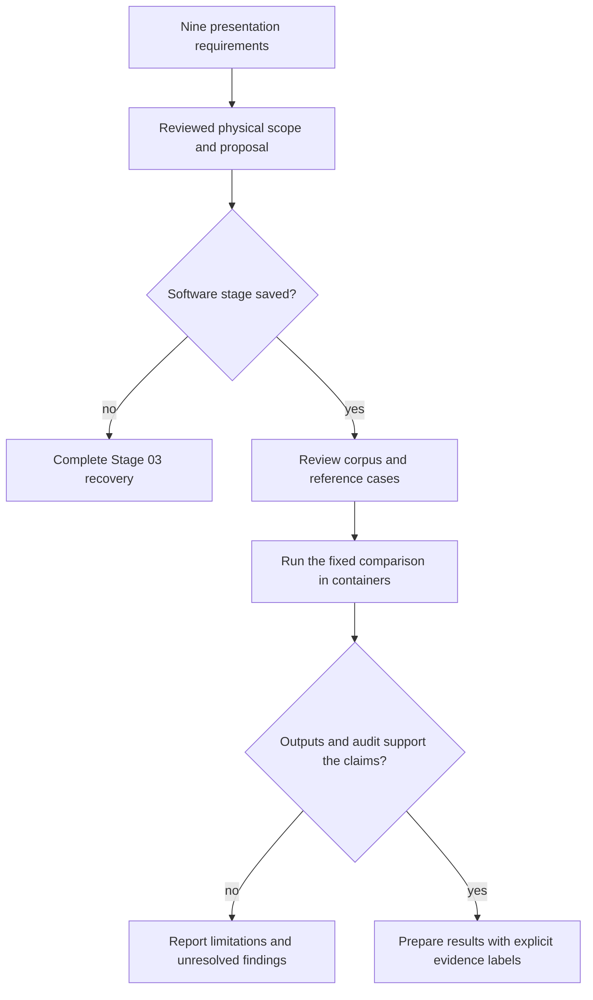

# Presentation requirements and project evidence

Prepared 2026-10-15 against the supplied one-page final-presentation guidelines. The original file is retained without modification at [requirements/final-presentation-guidelines.pdf](requirements/final-presentation-guidelines.pdf).

Original-source SHA-256: `8b5b33dd9c769027b70dccf9333d3a8b1a59b1b5017cad70d74198acef08a067`.

## Project framing

Working title: **Reliability of Local LLMs for Ideal Rocket-Nozzle Performance Reasoning: An Evidence and Physics Audit**.

The selected broad area remains **ML-Based Rocket Nozzle Performance Prediction**. This study evaluates pretrained LLM reasoning rather than training a CFD surrogate or claiming a new nozzle design. The propulsion contribution is a physically defined audit of numerical predictions, units, operating assumptions, and supporting evidence. Acceptance of that interpretation by the instructor has not yet been established.

The guidelines require a justified proposal, technical understanding, and analysis; a literature summary alone will not meet them. The existing manifesto supplies the proposed study. Later stages must supply reviewed propulsion cases, independent reference calculations, and measured evidence before the final presentation is described as complete.

## Requirement mapping

| Guideline point | What this project should present | Existing basis and remaining evidence |
| --- | --- | --- |
| 1. Topic rationale | Why nozzle performance is a useful, physically checkable setting for studying LLM reliability; relation to the chosen broad area | Manifesto sections 1-2; retain the distinction between LLM reasoning and a trained numerical surrogate |
| 2. Motivation and significance | Why unsupported thrust, unit, or applicability claims matter in propulsion education and engineering review | Manifesto sections 3, 5, and 11; describe a research/education tool, with no operational engine-design claim |
| 3. State of the art | Compare recent LLM/RAG reliability work, physics-aware validation, and numerical nozzle prediction; explain what each actually demonstrated | Manifesto section 4 and literature-search record; inspect cited primary papers and refresh the search before submission |
| 4. Gap and challenges | A bounded, testable question about small local LLMs under shared nozzle assumptions, evidence, units, and resource limits | Manifesto sections 3 and 6; the gap remains a literature-supported working gap, not proof that nobody has studied it |
| 5. Proposed approach | Compare the same local model with and without BM25 retrieval on reviewed ideal-nozzle questions; audit both with an independent evaluator | Manifesto sections 8-10 and procedure diagrams; ordinary RAG is the comparison condition, not a claimed novel algorithm |
| 6. Justification | Link the evaluation to conservation-based nozzle relations and dimensional consistency. Explain why retrieved equations may help evidence use yet leave arithmetic errors | Manifesto sections 7 and 10; reference calculations remain separate from the answering system so the comparison is fair |
| 7. Theory and computation | Show assumptions, equations, a worked reference case, branch selection, unit checks, and a controlled computational comparison | Mathematical scope exists in manifesto section 7; numerical gold cases, tests, and measurements are still pending. Run those calculations in disposable containers |
| 8. Expected results | State competing hypotheses and measurable outcomes: numerical accuracy, units, evidence support, applicability, runtime, and memory | Manifesto sections 6 and 11. No improvement percentage is supported yet; zero or negative RAG benefit is a valid result |
| 9. Potential impact | A reusable teaching/audit benchmark and a documented path for later tool-assisted or physics-aware remedies | Manifesto sections 11-12; distinguish possible future remedies from implemented or validated improvements |

## Propulsion analysis that must remain central

Keep the physical system explicit: steady one-dimensional, calorically perfect, choked flow with a stated shock-free branch and applicable boundary conditions. Use the professor's notes for course notation and scope. Explain how chamber conditions, nozzle geometry, gas properties, and ambient pressure enter the predicted quantities.

The final analysis should connect the thrust relation

\[
F = \dot m V_e + (p_e-p_a)A_e
\]

to the reviewed area-Mach and isentropic relations already documented in the manifesto. A plausible sentence or a correct citation is insufficient evidence of a correct thrust prediction. Conversely, an ideal-model calculation does not establish real-engine performance, combustion chemistry, nozzle separation, or off-design shock behavior.

The planned design remains 12 development cases and 36 evaluation cases, with two answering conditions and three seeds: 216 evaluation responses if the measured runtime permits. These are planned counts. The development/evaluation separation, reference construction, case review, and pilot budget must be fixed before the full evaluation.

## Evidence labels for every future slide

| Label | Appropriate use now |
| --- | --- |
| Proposed | Benchmark design, LLM/RAG comparison, audit procedures, possible remedies |
| Expected | A stated hypothesis or a result direction supported by reasoning; include alternatives |
| Demonstrated software readiness | Only checks actually passed and recorded on the user's host |
| Demonstrated scientific result | A measured result with its case set, configuration, output files, and validation record; none exists at this checkpoint |
| Limitation | Ideal-flow assumptions, model dependence, corpus coverage, numerical-reference limitations, and runtime budget |

Do not present the hypothesis that retrieval helps as a finding. Do not convert generic benchmark improvements from other papers into an expected percentage for this project. Quantify the observed difference only after evaluation, with the relevant denominator and uncertainty.

## Presentation evidence gate

This mapping saves the requirements during Stage 03. It does not start Stage 04, create experimental results, or replace the earlier manifesto.
