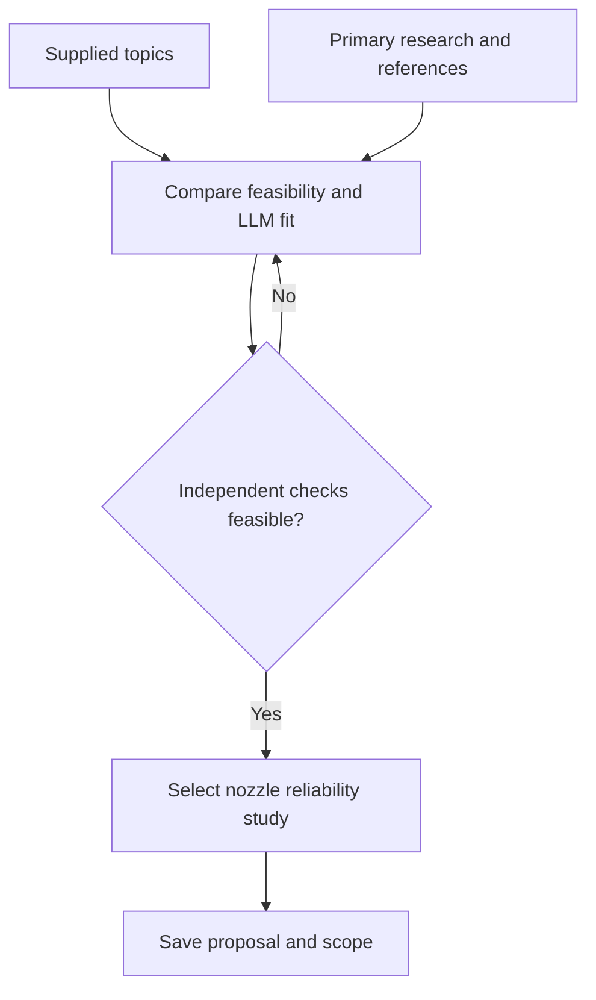
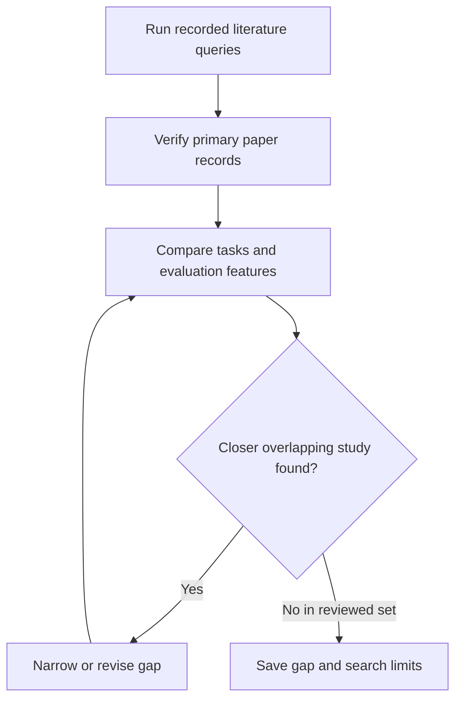
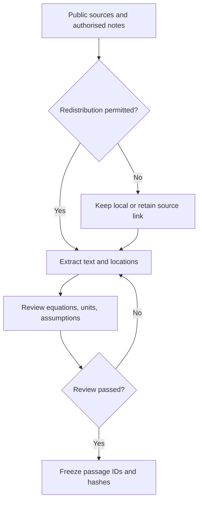
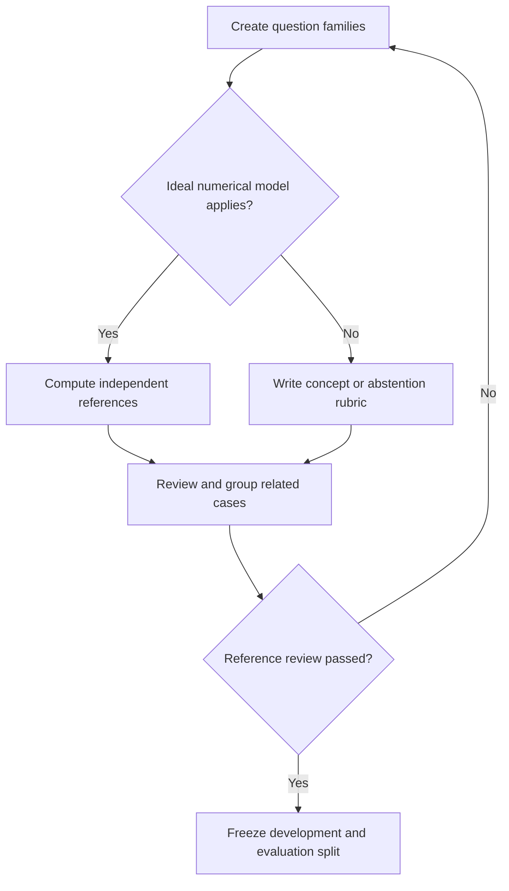
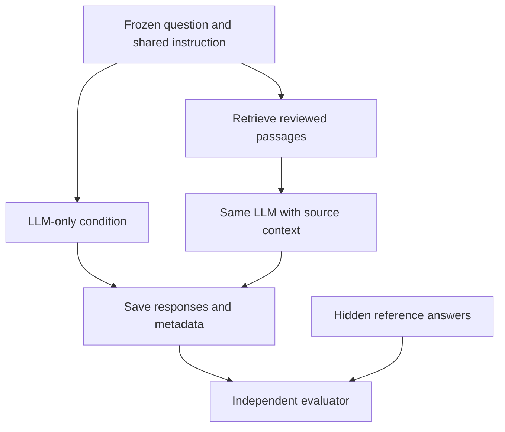
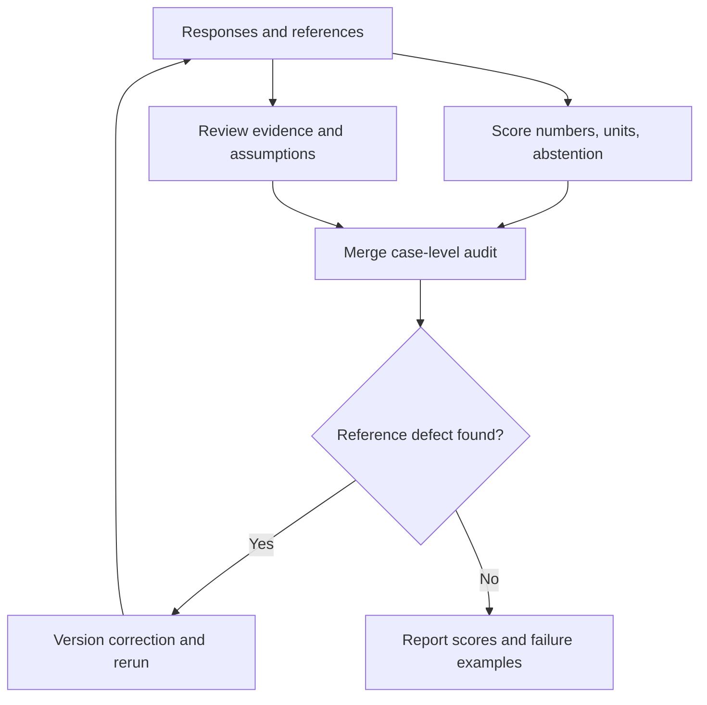
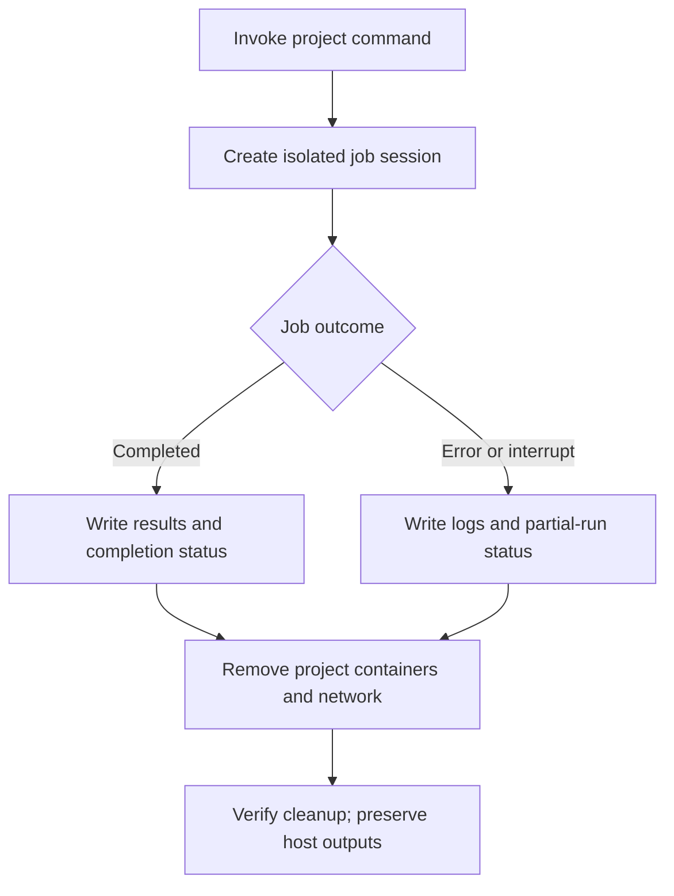
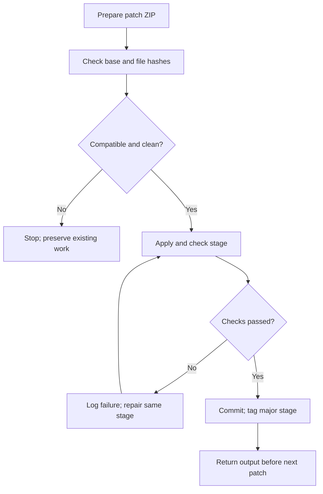

# RocketNozzle-LLM: project manifesto and research plan

**Proposed title:** *Reliability of Local Large Language Models for Rocket Nozzle Performance Prediction: Numerical Accuracy, Evidence, and Model Applicability*

**Selected course topic:** ML-Based Rocket Nozzle Performance Prediction.  
**Course / owner:** Rocket Propulsion / Heavenly-Cyber.  
**Local repository:** `~/git_work/rocket_proplusion_project/`.  
**Proposal and literature-search cutoff:** 14 October 2026.  
**Checkpoint:** Stage 01 / `v0.1.0` — documentation only.  
**Research status:** Proposed; no model experiment or measured project result exists yet.

## 1. What we are choosing

We will investigate whether a small local LLM can correctly answer rocket-nozzle performance questions, state its assumptions, cite supporting evidence, and recognise when it lacks enough information to calculate an answer.

The initial project compares the same model in two conditions:

1. **LLM only:** a question and fixed instruction, without retrieved documents or a calculator.
2. **LLM with retrieval-augmented generation (RAG):** the same question and instruction, plus passages retrieved from a small reviewed propulsion corpus.

A separate deterministic physics evaluator checks suitable numerical answers **after generation**. It never gives reference answers to either baseline. This lets us measure a gap without silently correcting the model.

For example, a model might recall the thrust equation but omit pressure thrust, confuse stagnation and static pressure, or apply a shock-free relation to a case containing an internal shock. These are testable failure modes, not findings already established by this project.

The first implementation produces a reproducible benchmark and failure report. It does not need to train a new foundation model, optimise a nozzle, or solve the identified reliability problem.

## 2. Why this topic fits best

This is a practical recommendation based on the requested LLM focus, a term-paper workload, public evidence, and independent answer checking. It is not a universal ranking of propulsion research areas.

| Candidate from the supplied document | Main advantage | Main difficulty | Decision |
| --- | --- | --- | --- |
| **ML-Based Rocket Nozzle Performance Prediction** | Direct course link; numerical and evidence checks can be transparent | Must distinguish ideal predictions from real nozzle behaviour | **Selected** |
| ML-Based Rocket Motor Performance Prediction | Strong propulsion link | Broader coupling of chamber processes, propellant properties, and nozzle flow | Too broad initially |
| ML for Solid Propellant Burning-Rate Prediction | Clear numerical task | Comparable experimental data and formulation-specific conditions are needed | Alternative if a reviewed dataset is available |
| ML for Hybrid Rocket Regression-Rate Prediction | Clear numerical task | Geometry and test conditions complicate data comparability | Alternative with a reviewed dataset |
| AI/ML for Combustion Instability Detection; Combustion Instability in Solid Rockets; Combustion Instability in Solid Rocket Motors | Valuable engineering problem | Labelled pressure time series and signal interpretation dominate | Weaker fit for a text-focused first project |
| AI-Assisted Nozzle Optimization; AI-Based Solid Propellant Grain Optimization | LLMs can propose or explain designs | Credible objectives, constraints, and validation expand the workload | Larger follow-up |
| Dual-Bell Nozzles; Aerospike Nozzles: Performance and Practical Challenges | Excellent literature subjects | Independent numerical references require more sophisticated modelling | Future extension |
| Regenerative Cooling for Liquid Rockets; Advanced Injectors for Liquid Rockets | Strong engineering content | Coupled thermal/fluid effects complicate reference checking | Future extension |
| Hydrogen vs Methane vs Kerosene for Liquid Rocket Engines; Sustainable Fuels for Rocket Propulsion | Good evidence-comparison tasks | Easily becomes a generic literature chatbot | Weaker quantitative fit |
| Advanced Oxidizers for Hybrid Rocket Propulsion; Advanced Oxidizers for Hybrid Rockets; Metallized Solid Propellants; Boron-Based Fuels; Metal-Loaded Gel Fuels for Ramjet Propulsion; Green Hypergolic Propellants | Good structured literature subjects | Chemistry and operating conditions complicate comparability | Better separate evidence studies |
| Additive Manufacturing of Rocket Engines | Strong LLM literature fit | Materials, processing, inspection, and performance make scope broad | Too broad initially |

Repeated combustion-instability and oxidizer themes are grouped. One document line combines aerospike and advanced-oxidizer headings; they are treated as separate areas.

The selected topic gives us:

- Direct rocket-propulsion content: mass flow, exhaust velocity, pressure thrust, specific impulse, and expansion conditions.
- Standard ideal-flow equations for carefully restricted numerical reference cases.
- Public technical evidence without needing proprietary engine measurements.
- A compact corpus and benchmark suitable for local inference.

**Course alignment:** LLMs are machine-learning models, but this proposal evaluates pretrained language models rather than training a conventional numerical regression surrogate. The title and submission must make that distinction clear. Instructor acceptance of this interpretation has not been established by the topic list alone.

## 3. The working research gap

> The reviewed literature does not establish the reliability of small local LLMs, with and without retrieval, on a reproducible rocket-nozzle question set that jointly checks numerical performance, units, source support, assumption applicability, and appropriate abstention.

This is a **bounded synthesis of reviewed sources**, not proof that no related benchmark exists anywhere. It is an evaluation/application gap, not a claim that LLMs have never been used for rockets, nozzles, thermodynamics, or physics-aware CFD.

The missing evidence concerns this combination:

1. Rocket-nozzle performance questions.
2. A locally feasible model configuration, including quantisation and inference settings.
3. Independent numerical and unit checks under explicit physics assumptions.
4. Audited citations and cases with missing or unsupported inputs.
5. A repeatable comparison of the same model with and without retrieval, retaining failures.

Related studies already cover parts of this combination. If a closer prior study is found, we must narrow or revise the claim. See [LITERATURE_SEARCH.md](LITERATURE_SEARCH.md) for the search boundary and evidence limits.

## 4. What others have tried

These are author-reported studies, not results reproduced here. An arXiv preprint is labelled as such; availability on arXiv does not establish peer review. Source records and relevant accessible sections were checked as described in the search log.

| Source | Prior approach | Relevance and remaining question |
| --- | --- | --- |
| **[P1] Yang et al., 2026 — combustion knowledge injection / CombustionQA** | Combustion corpus, 436-question benchmark, controlled retrieval | Its full text reports 58.24% Optimal RAG accuracy versus 23.35% zero-shot and 87.3% with supplied source context. These are study-specific scores. Does a small local model show similar failure types in nozzle QA? |
| **[P2] Düzkar, 2026 — ThermoQA** | 293 engineering thermodynamics problems, programmatic references, repeated evaluations | Component questions already include nozzles. Our proposed scope adds rocket pressure thrust, local quantisation, evidence support, and abstention; numerical thermodynamics evaluation is not a new idea. |
| **[P3] Fan et al., 2026 — PhyNiKCE** | Symbolic physics validation and retrieval for autonomous CFD, including nozzle cases | Direct precedent for physics-aware validation. We investigate a much smaller nozzle-QA setting without autonomous CFD; combining physics and LLMs is not our claimed novelty. |
| **[P4] Fan et al., 2025–2026 — ChatCFD** | Structured knowledge and iterative error handling for OpenFOAM automation, including supersonic nozzles | Separates successful execution from physical fidelity. Our initial study instead audits answer values, units, citations, and assumptions under a local inference budget. |
| **[P5] Simonds, 2025 — RocketBench** | LLM interaction with rocket simulations for design tasks and reinforcement learning | Direct LLM-rocketry precedent. We evaluate nozzle answers rather than train a rocket-design optimiser. |
| **[P6] Sharma and Raman, 2024 — combustion knowledge processing** | Local/open-model RAG, segmentation, prompting, and reliability in literature processing | Domain-specific retrieval precedent. We add a structured numerical and evidence audit. |
| **[P7] Brahmachary et al., 2024 — LEO** | LLM-based optimisation, including supersonic nozzle shape examples | Prevents an inaccurate claim that LLMs have not been used for nozzle design. Our focus is controlled answer reliability. |

The February–March 2026 papers [P1–P3] provide recent support as of the search cutoff. Results from different papers are not directly comparable performance targets.

## 5. Why the gap may persist

These are plausible explanations to investigate, informed by related work, not proven causes in our future experiment.

| Possible cause | Nozzle-specific implication | Observable evidence |
| --- | --- | --- |
| Language similarity is not physical compatibility | A relevant-looking passage may assume a different flow regime | Label source assumptions and inspect failed answers |
| Formula recall does not ensure calculation accuracy | Plausible steps can give a wrong final value | Score values, units, and assumptions separately |
| Extraction can damage subscripts and equations | Lost pressure notation changes a formula's meaning | Manually review the small corpus |
| Retrieval can miss evidence or introduce distractors | Similar terminology can retrieve incompatible information | Record passage IDs and review support |
| Local resource limits define a different model setting | Quantisation and context size may affect observed behaviour | Record the exact model/runtime configuration; avoid causal claims without controlled comparisons |
| Abstention is difficult to reward and assess | A fabricated number can sound more useful than clarification | Include explicit missing-input and unsupported-model cases |
| Broad benchmarks test different tasks | Thermodynamics QA, CFD execution, and rocket optimisation differ | Publish a prior-work feature comparison |

## 6. Research questions

- **RQ1:** How often does the local LLM produce correct numerical nozzle answers under an applicable ideal model?
- **RQ2:** Does retrieval improve accuracy and evidence support for the same model, and for which question types?
- **RQ3:** Does it recognise missing inputs, inconsistent quantities, or an inapplicable ideal-flow assumption?
- **RQ4:** Which failures concern retrieval, interpretation, calculation, citations, or faulty reference data?
- **RQ5:** Are behaviours reasonably consistent across repetitions and wording variations at the chosen resource budget?

We may expect retrieval to improve evidence support more consistently than arithmetic, but this is a hypothesis. Strong baseline performance, little improvement, or worse RAG performance are valid outcomes. We will not select results to make the gap appear larger.

## 7. Physics scope and reference boundary

The numerical subset uses a restricted textbook model: steady, one-dimensional, adiabatic, inviscid, calorically perfect ideal-gas flow with fixed composition. Choked, shock-free operation and the appropriate branch must be explicit conditions of each suitable case.

| Symbol | Meaning | Reference unit |
| --- | --- | --- |
| `p0`, `T0` | Chamber/reservoir stagnation pressure and temperature | Pa, K |
| `pe`, `pa` | Exit static pressure and ambient pressure | Pa |
| `At`, `Ae` | Throat and exit areas | m² |
| `gamma` | Fixed-model specific-heat ratio | Dimensionless |
| `R` | Specific gas constant, not universal molar gas constant | J/(kg K) |
| `mdot`, `Ve` | Mass-flow rate and exit velocity | kg/s, m/s |
| `F`, `Isp` | Thrust and specific impulse | N, s |

The thrust equation is:

$$F=\dot{m}V_e+(p_e-p_a)A_e.$$

For applicable choked ideal flow:

$$\dot{m}=A_t p_0\sqrt{\frac{\gamma}{R T_0}}\left(\frac{2}{\gamma+1}\right)^{\frac{\gamma+1}{2(\gamma-1)}}.$$

For applicable isentropic expansion:

$$V_e=\sqrt{\frac{2\gamma}{\gamma-1}RT_0\left[1-\left(\frac{p_e}{p_0}\right)^{(\gamma-1)/\gamma}\right]}.$$

Performance quantities include:

$$I_{sp}=\frac{F}{\dot{m}g_0},\qquad C_F=\frac{F}{p_0 A_t},\qquad g_0=9.80665\;\mathrm{m/s^2}.$$

If area ratio is supplied, solve the area–Mach relation on the explicitly appropriate branch. Do not choose a subsonic root for a stated supersonic exit. Missing required information leads to a clarification reference, not a guessed value.

A pressure ratio alone is not a universal guarantee of shock-free operation for every converging–diverging nozzle. Internal shocks, separation, variable specific heats, reacting/two-phase flow, heat transfer, and erosion are outside this reference model. Such questions belong to conceptual or abstention subsets unless separately reviewed references are available.

An underexpanded exit has `pe > pa`; an overexpanded exit has `pe < pa`. For a fixed ideal exit state and geometry, `pe = pa` removes pressure mismatch. This is not a guarantee that an arbitrary real nozzle flow remains attached.

NASA Glenn references [T1–T2] support the textbook relations. T1 denotes chamber total pressure by `pt` and ambient pressure by `p0`; this proposal uses `p0` and `pa`, respectively. Preserve that mapping when curating passages. Professor-provided notes take precedence for course notation and syllabus; no unseen class material is claimed to have been checked. The evaluator verifies ideal-model predictions, not experimental engine performance.

## 8. Minimum viable benchmark

Begin with a 12-case smoke subset, then freeze a **48-case benchmark**: 12 development and 36 evaluation cases. These are planned counts, not a collected dataset.

| Family | Planned cases | Reference method |
| --- | --- | --- |
| Concepts: choking, pressure thrust, expansion, static/stagnation quantities | 8 | Reviewed technical-source rubric |
| Direct ideal numerical calculations | 12 | Deterministic equations and independent spot checks |
| Unit/notation variations of numerical cases | 8 | Equivalent SI references; grouped with original families |
| Evidence questions requiring source support | 8 | Reviewed claim-to-passage mapping |
| Missing, inconsistent, or unsupported inputs | 12 | Reviewed clarification/qualified-abstention rubric |

Related variants and paraphrases stay in the same split. Gold values, evidence labels, and grading rubrics remain outside inference context. Source passages may contain legitimate equations, but never exact benchmark worked answers.

Freeze the split, tolerances, sources, and prompts before examining evaluation responses. Development cases can guide repairs; evaluation cases cannot be used for tuning and then represented as untouched tests.

Use one local model initially. Both conditions on 36 cases with three repetitions give **216 planned responses**, subject to measured runtime. A reduced run must be labelled a pilot, with its plan fixed before inspecting outcomes. A second model is optional later work.

## 9. Procedures and diagrams

Mermaid diagrams render on GitHub. Each procedure states the actual work and output.

### A. Select and justify the topic

**Work:** Compare topics, establish the course link, document bounded scope, and save before implementation.  
**Output:** This proposal and the `v0.1.0` documentation checkpoint.

### B. Verify the literature gap

**Work:** Record queries, dates, authors, versions, publication status, overlap, and evidence limits; follow relevant references.  
**Output:** Search log, bibliography, and revised comparison when necessary. A negative search is not proof of absence.

### C. Curate retrieval evidence

**Work:** Keep a small reviewed corpus, source URLs and page/section locations, licensing status, and clear separation between our notes and quotations. Non-redistributable content stays local.  
**Output:** Source manifest, reviewed text, and retrieval index under `data/`.

### D. Build the benchmark

**Work:** Author original questions, check units/equations, independently verify representative references, and prevent family leakage.  
**Output:** Question schema, references, split manifest, and scoring tolerances; references separate from model inputs.

### E. Generate controlled responses

**Work:** Keep model, quantisation, settings, and output format identical; change source context only. Record retrieval IDs, seeds, context lengths, timings, and failures. Model-generated code is never executed.  
**Output:** Raw responses and run metadata in `resutls/<run_id>/`; operational logs in `logs/<run_id>/`.

### F. Audit and report

**Work:** Score all planned cases, retain timeouts/malformed answers, inspect error causes, and report uncertainty. Corrected references require a new benchmark version.  
**Output:** Audit table, charts, error taxonomy, and qualified gap report.

### G. Execute and remove containers

**Work:** Run ingestion, indexing, inference, evaluation, tests, and report generation in temporary containers. Inputs are read-only; designated outputs/caches are writable. Use a non-root user, dropped capabilities, resource limits, and no Docker-socket mount. Prepared inference defaults offline.  
**Output:** Persistent results/logs and no project container left running. Trap normal exits and interrupts; an explicit recovery-cleanup command handles uncatchable termination or host crashes. Never prune unrelated Docker resources. Images and model caches may remain; stopped job containers are removed.

### H. Save before the next stage

**Work:** Apply without overwriting unrelated changes, verify, commit every smaller change, and tag completed major stages. A commit, pushed tag, and GitHub Release are distinct checkpoints.  
**Output:** Saved local checkpoint and returned output; remote publication uses the verified Heavenly-Cyber account.

## 10. Scoring and fair evaluation

| Measurement | Planned rule |
| --- | --- |
| Numerical correctness | Canonical SI comparison: `abs(pred - ref) <= max(atol, rtol * abs(ref))`; start with `rtol = 0.01` and reviewed per-quantity `atol` |
| Unit correctness | Check unit dimension/conversion separately; a right number with a wrong dimension fails combined correctness |
| Coverage | Missing required quantities remain in denominators |
| Citation validity | Source ID exists and location is traceable |
| Citation support | Reviewed passage actually supports the associated claim; citation presence alone is insufficient |
| Retrieval quality | Recall of reviewed required passages at a frozen retrieval limit |
| Applicability | Rubric for flow regime, total/static quantities, and permitted assumptions |
| Abstention | Appropriate abstention on unsupported cases and false abstention on answerable cases, reported separately |
| Robustness | Grouped variants, paraphrases, and recorded repetitions |
| Resources | Wall time, exposed token/context counts, hardware, and measured memory where available |

Freeze absolute tolerances before evaluation; percentage error is inadequate near zero. Qualitative answers use a published human-review rubric. A second reviewer is desirable when available; disclose a single reviewer and retain annotations otherwise. An LLM judge is not sole ground truth.

Report uncertainty using case-family-level resampling or clearly labelled intervals. Repetitions and paraphrases are correlated, not independent extra questions. Use paired condition differences. A small benchmark cannot justify broad industrial reliability claims.

Mock runs may test plumbing but never contribute research scores. If actual inference cannot complete, report the limitation rather than presenting synthetic measurements.

## 11. Possible outcomes

| Possible finding | Defensible interpretation | Later direction |
| --- | --- | --- |
| RAG improves citations but not numerical accuracy | Evidence access and calculation reliability differ in this setting | Tool-assisted calculations |
| Retrieval hurts some answers | Distractors or incompatible assumptions may matter | Assumption-aware filtering |
| Numerical answers are strong but unsupported cases receive invented values | Missing-information handling remains weak | Input schemas and abstention policies |
| Both conditions perform well | The gap is small for these cases/model | Explicitly versioned harder or broader cases |
| Both perform poorly | This local configuration has limited reliability | Diagnose reference, prompt, retrieval, and model factors separately |
| Hardware cannot support the planned run | Resources constrain this experiment | Smaller context/model or a labelled reduced pilot |

Useful outcomes include a reviewed benchmark, transparent evaluator, reproducible recipe, failure audit, and literature-supported term paper. No improvement percentage is promised.

## 12. Possible remedies: future work only

| Failure | Candidate remedy | Still needs evaluation |
| --- | --- | --- |
| Arithmetic/units | LLM extracts structured inputs; deterministic tool computes | Input-extraction errors and propagation |
| Wrong model regime | Explicit applicability checks before calculation | Boundary coverage and false rejection |
| Distracting retrieval | Assumption-labelled passages, filters, reranking | Held-out benefit and resource cost |
| Unsupported claims | Claim-to-passage validation and evidence-aware refusal | Review agreement and over-refusal |
| Missing-input guesses | Required-input schema and clarification response | Balanced answerability/abstention |
| Weak domain reasoning | Targeted adaptation or bounded fine-tuning | Data, leakage, compute, generalisation |

These extend existing tool-use and physics-aware retrieval ideas, including [P3]. They are hypotheses, not solutions implemented or proven here. Ordinary RAG is a comparison baseline; the reference calculator stays outside the answering system.

## 13. Environment requirements before package selection

Stage 02 will freeze packages and a model **after this document is saved and the system summary is returned**. Stage 01 does not claim verified compatibility or a latest version.

Proposed architecture:

- Python CLI research project; `uv` manages the checked-in lock and frozen installs inside Docker.
- Docker job execution; any internal inference service lasts only for the job.
- Compact local inference runtime; CPU path required, GPU optional after driver checks.
- Small retrieval component; no database server is necessary simply to store a compact corpus.
- Separate configuration, validation, logging, plotting, and report components.
- Git and the requested stage-by-stage ZIP patch workflow.

`pnpm` becomes relevant if a JavaScript interface is justified later. The initial CLI does not require a second package ecosystem. Actual choices will use official documentation and pinned compatible versions/image digests, checked against hardware and licences.

Record model revision/checksum, quantisation, tokenizer/chat template, context limit, runtime revision, dependency lock, container digest, dataset/source hashes, prompt version, seeds, and Git commit/tag. Docker isolation does not guarantee bit-identical GPU generation across hardware. Cold setup requires downloads; prepared CPU experiments should run offline.

Host commands install files, manage Git, inspect prerequisites, and build/start containers. Scientific processing and package-managed project tasks run inside containers. Host GPU drivers/container support remain prerequisites. No permanent research service is required.

## 14. Planned repository and output policy

| Path | Purpose | Git policy |
| --- | --- | --- |
| `src/rocket_nozzle_llm/` | Research code | Tracked |
| `scripts/` | Host patch, launch, inspection, cleanup commands | Tracked |
| `tests/` | Physics-reference, split, and lifecycle checks | Tracked |
| `configs/` | Non-secret settings/manifests | Tracked |
| `docker/` | Docker build/job definitions | Tracked |
| `docs/` | Proposal, sources, methods, manuals, report | Tracked |
| `data/benchmark/` | Original reviewed questions and references | Tracked if permitted |
| `data/raw/`, `data/processed/`, `data/index/` | Local sources/extractions/index | Generated/restricted files ignored |
| `models/` | Downloaded weights | Ignored; manifests elsewhere |
| `resutls/<run_id>/` | Responses, scores, plots, report, run/status manifest | Generated files ignored; release outputs deliberately curated |
| `logs/<run_id>/` | Errors, stderr, timings, diagnostics | Ignored |
| `cache/`, `tmp/` | Bounded disposable caches/temp files | Ignored |

**`resutls/` and `rocket_proplusion_project` retain the exact requested spellings.** Root files are stable entry/configuration files such as `README.md`, `.gitignore`, `.dockerignore`, `pyproject.toml`, and `uv.lock`; regenerating outputs live in separate folders. Run IDs are unique, earlier outputs are preserved, and incomplete runs have an explicit status.

Do not push raw logs, credentials, model weights, private course files, or unreviewed generated outputs. Publish selected reports/results in deliberate release artifacts after reviewing contents.

## 15. Interactive stages and saving gates

| Stage | Work | Major checkpoint | Return before continuation |
| --- | --- | --- | --- |
| **01 — proposal** | Rationale, gap, diagrams, sources, manual | Documentation commit + annotated `v0.1.0` | Installer status and read-only system summary |
| **02 — stack decision** | Verify prerequisites; freeze package/model/container choices | Commit + `v0.2.0` | Stack-decision patch output |
| **03 — reproducible scaffold** | Locked build, launch/cleanup, directory rules, smoke check; GitHub setup | Commit + `v0.3.0` | Build/check results and verified remote |
| **04 — corpus/benchmark** | Reviewed sources, references, split, evaluator | Commit + `v0.4.0` | Reference-validation and dataset summary |
| **05 — basic LLM study** | Real containerised LLM-only/RAG runs and audit | Commit + `v0.5.0` | Actual outputs and cleanup status |
| **06 — term-paper package** | Findings, charts, gap discussion, manuals, reproduction check | Commit + `v1.0.0` | Final report and reproduction evidence |

Commit smaller changes before advancing. Push annotated tags after checks pass. Publish major GitHub Releases when their concrete artifacts are ready; a local tag is not a published release. Verify the Heavenly-Cyber login before repository creation or pushing. Never embed a token in a patch/container.

Stage 01 bootstraps **documents and Git history only**, saving the proposal before environment decisions. It installs no research package, downloads no model, creates no remote repository, and runs no experiment. The next patch depends on the returned state. This is the user's requested interaction gate, not a separate skill-imposed approval.

## 16. Final basic demonstration and paper

A later command will run frozen questions through both model conditions and write a report containing run identity, actual scores by family, error types, traceable examples, limitations, and whether findings support or narrow the working gap.

Term-paper outline: introduction; nozzle physics; related work; bounded gap; benchmark/methods; measured results; error discussion; limitations; possible remedies; conclusion; references; reproduction appendix.

The contribution is a documented **measurement of reliability in a specific setting**. Its value depends on fair evaluation and reviewed references, not an unsupported claim that an LLM replaces a physical solver.

## 17. References

**[P1]** Zonglin Yang, Runze Mao, Tianhao Wu, Han Li, QingGuo Zhou, and Zhi X. Chen. *A unified foundational framework for knowledge injection and evaluation of Large Language Models in Combustion Science*. 2026. arXiv preprint v1; primary record lists submission on 27 February 2026. [Record](https://arxiv.org/abs/2603.04452) · [Full text](https://arxiv.org/html/2603.04452v1).

**[P2]** Kemal Düzkar. *ThermoQA: A Three-Tier Benchmark for Evaluating Thermodynamic Reasoning in Large Language Models*. 2026. arXiv preprint v1; primary record lists submission on 25 March 2026. [Record](https://arxiv.org/abs/2604.19758) · [Full text](https://arxiv.org/html/2604.19758v1).

**[P3]** E Fan, Lisong Shi, Zhengtong Li, and Chih-yung Wen. *PhyNiKCE: A Neurosymbolic Agentic Framework for Autonomous Computational Fluid Dynamics*. 2026. arXiv preprint v1, submitted 12 February 2026. [Record](https://arxiv.org/abs/2602.11666) · [Full text](https://arxiv.org/html/2602.11666v1).

**[P4]** E Fan, Kang Hu, Zhuowen Wu, Jiangyang Ge, Jiawei Miao, Yuzhi Zhang, He Sun, Weizong Wang, and Tianhan Zhang. *ChatCFD: An LLM-Driven Agent for End-to-End CFD Automation with Structured Knowledge and Reasoning*. First submitted 28 May 2025; arXiv v3 dated 7 February 2026; record supplies a related journal DOI. [Record](https://arxiv.org/abs/2506.02019) · [Journal DOI](https://doi.org/10.1002/aidi.202500174).

**[P5]** Toby Simonds. *LLMs for Engineering: Teaching Models to Design High Powered Rockets*. 2025. arXiv preprint v2, revised 29 April 2025. [Record](https://arxiv.org/abs/2504.19394).

**[P6]** Vansh Sharma and Venkat Raman. *A Reliable Knowledge Processing Framework for Combustion Science using Foundation Models*. *Energy and AI*, 16, 100365, 2024. arXiv v2 dated 2 January 2024. [Record](https://arxiv.org/abs/2401.00544) · [Journal DOI](https://doi.org/10.1016/j.egyai.2024.100365).

**[P7]** Shuvayan Brahmachary, Subodh M. Joshi, Aniruddha Panda, Kaushik Koneripalli, Arun Kumar Sagotra, Harshil Patel, Ankush Sharma, Ameya D. Jagtap, and Kaushic Kalyanaraman. *Large Language Model-Based Evolutionary Optimizer: Reasoning with elitism*. 2024. arXiv v1, submitted 4 March 2024. [Record](https://arxiv.org/abs/2403.02054).

**[T1]** NASA Glenn Research Center. *Thrust Equations Summary*. Primary technical reference, accessed 14 October 2026. [Current page](https://www1.grc.nasa.gov/beginners-guide-to-aeronautics/thrust-equations-summary/).

**[T2]** NASA Glenn Research Center. *Compressible Area Ratio*. Primary technical reference, accessed 14 October 2026. [Page](https://www.grc.nasa.gov/www/k-12/rocket/astar.html).

**Topic-list source:** User-supplied `Some tentative broad areas for Term Paper Topics(1).docx`, read directly from the attachment. It gives candidate areas, not a deadline, rubric, or acceptance of this specific project.

