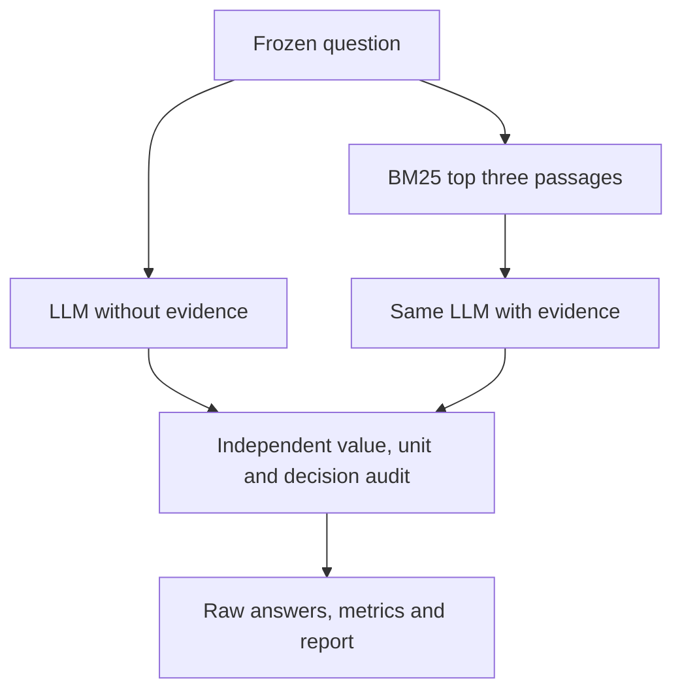

# Local LLM reliability for ideal rocket-nozzle performance

**Author:** Heavenly, Aerospace Engineering, IIT Kharagpur.  
**Course:** Rocket Propulsion. **Date:** 15 October 2026.

## Abstract

This basic project investigates whether a compact local language model can produce physically valid ideal-nozzle answers and whether BM25 retrieval changes that reliability. It supplies a frozen original benchmark, an independent deterministic reference, unit-aware scoring, raw-response retention, and disposable container execution. A six-case presentation pilot compares two conditions with one seed. The full mode uses 36 evaluation cases, two conditions and three seeds. Measured scores are written by an actual local run, not inserted into this document beforehand. The project supports a technically justified proposal and transparent preliminary measurement rather than operational engine-design claims.

## 1. Topic selection and motivation

The selected broad area is ML-Based Rocket Nozzle Performance Prediction. The present implementation audits predictions from a pretrained neural language model instead of training a CFD surrogate. Nozzle performance is suitable because mass flow, exit velocity and thrust have physically interpretable ideal references. A plausible answer can still confuse stagnation/static conditions, omit pressure thrust, choose a wrong Mach branch or mishandle units. Those failures matter in propulsion education and in the review of engineering assistants.

## 2. State of the art and research gap

Yang et al. (2026) describe a combustion knowledge-injection and evaluation framework, including retrieval. Düzkar's ThermoQA (2026) evaluates thermodynamic reasoning using programmatic references. Fan et al.'s PhyNiKCE (2026) brings physics-aware validation into autonomous CFD. ChatCFD (2025, revised 2026) provides a structured LLM-based CFD workflow. These studies establish substantial related work. The three 2026 records are preprints. Their reported improvements are not transferred to this model or benchmark.

The bounded working gap is: **within the reviewed studies, the joint local-model evaluation of ideal-nozzle values, units, evidence traceability, applicability and abstention remains insufficiently characterised.** This is a scoped review, not an exhaustive novelty search. The project does not claim to be the first LLM application to nozzles.

The gap persists because evidence retrieval, numerical calculation, physical-model selection and missing-data handling are different tasks. A retrieved equation may help source access without ensuring correct arithmetic. Broader CFD agents also have different tools, models and computational budgets from a small local answering system.

## 3. Physical model and justification

Assume steady one-dimensional flow of a calorically perfect ideal gas. The choked throat and shock-free supersonic branch must be explicit. Chamber conditions are stagnation quantities. The reference uses:

\[
F=\dot m V_e+(p_e-p_a)A_e,
\quad T_e=T_0/[1+(\gamma-1)M_e^2/2],
\quad V_e=M_e\sqrt{\gamma R T_e}.
\]

The area–Mach relation is

\[
\frac{A}{A^*}=\frac1M\left[\frac{2}{\gamma+1}\left(1+\frac{\gamma-1}{2}M^2\right)\right]^{(\gamma+1)/(2(\gamma-1))}.
\]

Choked mass flow is

\[
\dot m=\frac{p_0A_t}{\sqrt{T_0}}\sqrt{\frac{\gamma}{R}}
\left(\frac{2}{\gamma+1}\right)^{(\gamma+1)/(2(\gamma-1))}.
\]

A bisection implementation and an independent SciPy `brentq` calculation cross-check the supersonic roots. The exact identity `A/A*=1.6875` at `M=2, gamma=1.4` and throat-to-exit mass continuity provide additional checks. These checks establish consistency of the ideal reference, not fidelity to combustion chemistry, shocks, viscous losses or separation.

For an analytic worked example, `p0=1 MPa`, `T0=900 K`, `At=0.001 m²`, `M_e=2`, `gamma=1.4`, `R=287 J/(kg K)` and `pa=100 kPa` give `Te=500 K`, `Ae/At=1.6875`, and approximately `Ve=896.4 m/s`, `pe=127.8 kPa`, `mdot=1.347 kg/s`, `F=1.255 kN`. The container reference command writes full precision and the validation record. These are theoretical values, not LLM or engine measurements.

## 4. Proposed comparison and implemented method

The same Qwen3.5-4B Q4_K_M model answers each question in two conditions: no supplied passages, or the top three BM25 passages from a fixed short technical corpus. The model uses the already selected llama.cpp CPU runtime, fixed chat template and direct-answer mode. The answering prompt receives the question and any retrieved passages. It never receives the reference value or expected issue label. Only after the response arrives does the evaluator compute the reference.

The original template-generated dataset has 48 cases in six families: choked mass flow, supplied-state thrust, exit velocity, mixed units, applicability and missing inputs. Two cases per family are development cases and six are evaluation cases. The presentation pilot selects one fixed evaluation case per family, two conditions and seed 17, giving 12 requests. Full mode uses all 36 evaluation cases with seeds 17, 43 and 101, giving 216 requests. Human expert review has not been completed. Similar templates and repeated seeds are correlated, so the pilot is descriptive and supports no broad statistical significance claim.

The corpus consists of original educational paraphrases linked to NASA/NIST sources. It contains equations and assumptions, not numerical answers to the benchmark. Ordinary RAG is a comparison baseline. The project does not demonstrate a remedy that eliminates the gap.

## 5. Evaluation and limitations

The primary combined score requires the correct answer/abstention decision and, for numeric questions, the correct converted value within `max(atol, 0.01*abs(reference))`. Pint checks dimensions and conversion. Malformed JSON and missing answers remain in denominators. Applicability questions use predefined issue labels. Empty direct answers and unavailable requests cannot establish a complete run.

The audit separately retains schema validity, raw-number comparison, unit dimensionality, decisions, retrieved-source recall, cited-ID validity and runtime. Citation metrics apply within RAG because the baseline receives no passages. An ID match is not evidence that every associated claim is supported. `human-review.csv` explicitly leaves physical-reason and citation-support review pending. The report records exposed token counts but does not claim measured peak memory. Limits are recorded separately from measured runtime.

Partial runs retain outputs and are labelled partial. They do not earn the Stage 05 or final success tag. No synthetic answers contribute to experimental scores.

## 6. Demonstrated and expected results

The returned local log demonstrates the prior environment checkpoint: 65 tests and Ruff passed, model SHA-256 verified, local model API passed, and project containers/private network removed. Annotated `v0.3.0` targets commit `1ce2f541df1c3c17d009db4dd5879f3d1ecfd095`. Those are software-readiness results.

The final workflow adds container tests, reference analysis and real inference. Its actual result is saved under `resutls/<run-id>/study-report.html` and, after complete local measurement, `docs/RESULTS_SUMMARY.md`. This source document intentionally contains no fabricated improvement percentage.

Possible findings include improved numerical correctness, evidence access without numerical improvement, harm from distracting context, or little difference. All are valid. A later solver-assisted answering system, required-input schema or assumption-aware retrieval could target observed failures, but each would need a new controlled experiment.

## 7. Impact and reproducibility

The intended contribution is an inspectable teaching/research audit. It connects model answers to explicit propulsion equations and preserves failed cases for discussion. It does not certify a language model for real-engine design.

Dependencies, model revisions/checksum and container images remain pinned to the completed environment. Scientific work runs in bounded nonroot disposable containers. Results use `resutls/`; logs use `logs/`; temporary work and caches use their dedicated ignored folders. Each source/evidence checkpoint is committed before dependent work. Completed major stages receive annotated tags, and publication preserves existing repository visibility and origin. GitHub publication failure does not erase local results.

## 8. Professor guideline mapping

| Requirement | Main slides |
|---|---|
| Topic rationale | 2–3 |
| Motivation and significance | 4 |
| State of the art | 5 |
| Research gap and challenges | 6 |
| Proposed approach | 10–12 |
| Physical/scientific justification | 7–10 |
| Theoretical and computational analysis | 7–15 and live report |
| Expected results | 16 |
| Potential impact | 18 |

## References

1. Yang et al. (2026), *A unified foundational framework for knowledge injection and evaluation of Large Language Models in Combustion Science*. https://arxiv.org/abs/2603.04452
2. Düzkar (2026), *ThermoQA: A Three-Tier Benchmark for Evaluating Thermodynamic Reasoning in Large Language Models*. https://arxiv.org/abs/2604.19758
3. Fan et al. (2026), *PhyNiKCE: A Neurosymbolic Agentic Framework for Autonomous Computational Fluid Dynamics*. https://arxiv.org/abs/2602.11666
4. Fan et al. (2025, revision 2026), *ChatCFD: An LLM-Driven Agent for End-to-End CFD Automation with Structured Knowledge and Reasoning*. https://arxiv.org/abs/2506.02019
5. NASA Glenn, *Thrust Equations Summary*. https://www1.grc.nasa.gov/beginners-guide-to-aeronautics/thrust-equations-summary/
6. NASA Glenn, *Compressible Area Ratio*. https://www.grc.nasa.gov/www/k-12/rocket/astar.html

Primary records checked 15 October 2026. The original professor guidelines and earlier manifesto/literature record remain in `docs/`.
