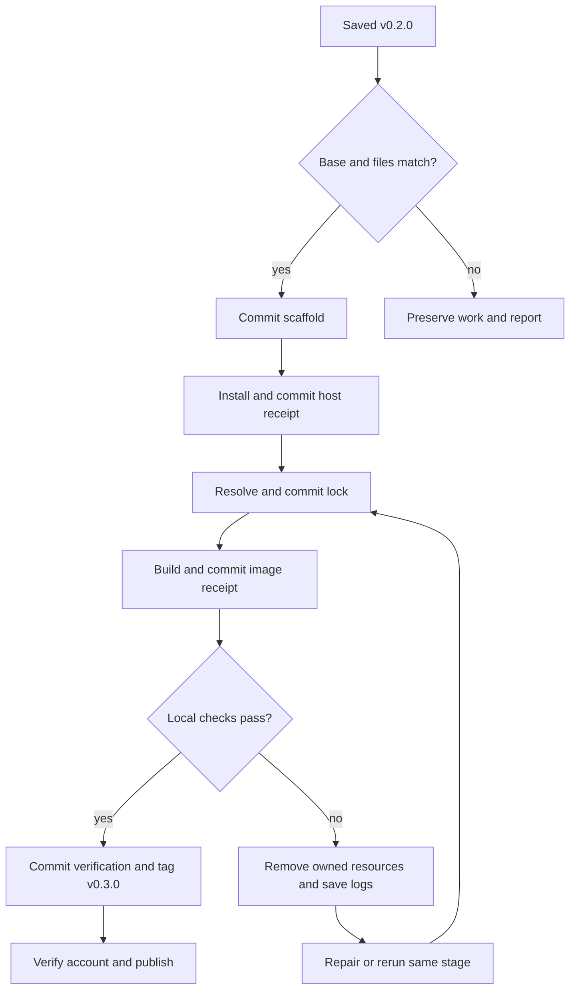
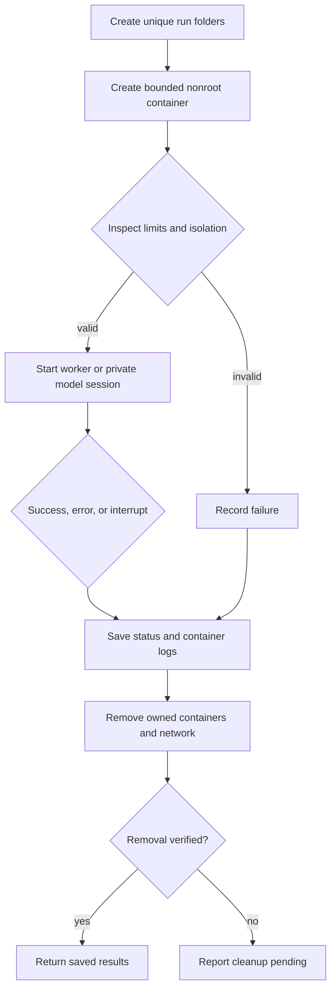

# Stage 03 — locked environment, disposable containers, and GitHub

> **Current recovery 04:** llama.cpp compiled and `configs/build-receipt.json` was saved in commit `45a9266`, after recovery 03 commit `98aff7d773eff0db2bd645107f669903af8f15c2`. The next Docker test run reported 35 passes and five failures caused by test assumptions about nonroot access and temporary-file execution. Use `rocket-project-stage-03-repair-04.zip` to save the test repair and resume. See [STAGE_03_REPAIR_04.md](STAGE_03_REPAIR_04.md). Available completed images and all immutable pins are retained.

> **Earlier recovery history:** [recovery 01](STAGE_03_REPAIR_01.md) repaired sudo terminal access; [recovery 02](STAGE_03_REPAIR_02.md) repaired Docker cleanup inspection and supported the existing SSH origin; [recovery 03](STAGE_03_REPAIR_03.md) repaired fixed-snapshot downloads and worker reuse. Installer 03a accepted the actual valid `==3.13.*` lock. Those ZIPs are anchored to earlier checkpoints; use recovery 04 for the current checkpoint and subsequent retries.

> **Existing SSH origin:** `git@github.com:Heavenly-cyber/rocket_proplusion_project.git` is retained. No second remote-add command is needed. The [presentation alignment](PRESENTATION_ALIGNMENT.md) maps the supplied course guidelines. Model readiness and scientific evaluation remain pending.

Original environment recorded 2026-10-14; recovery checkpoint updated 2026-10-15 for Pop!_OS 24.04 x86_64:

- Stage 02 commit: `4ea278f083c11d3fbc9044d1fadfaea88681f41f`.
- Annotated tag: `v0.2.0`; branch `main`; clean working tree.
- Local project: `~/git_work/rocket_proplusion_project/`.
- Host Python 3.12.3 runs the installer/orchestrator; research dependencies use container Python 3.13.16.
- 12 logical CPU threads, about 15.27 GiB physical RAM, last reported 7.89 GiB available RAM.
- Docker, Compose, and GitHub CLI were initially absent and were installed in the saved host-tools checkpoint. No GPU, host uv, Node, or pnpm is required.

## Apply this patch

For the current returned image-build checkpoint, save `rocket-project-stage-03-repair-04.zip` into `~/Downloads/` and run:

```bash
python3 "$HOME/Downloads/rocket-project-stage-03-repair-04.zip"
```

Run from your normal account. Do not put `sudo` before `python3`. The launcher requests sudo for signed APT installation and its local rootful Docker commands. Passwords are entered only in your terminal. Keep the terminal open and use the **Heavenly-Cyber** account during the GitHub sign-in flow. No model/provider API key is required.

The ZIP is an executable Python ZIP application. Do not unzip it into the project: its installer verifies the saved base, payload checksums, safe paths, and existing work before applying. It will not absorb unrelated changes, change Git author identity, disable signing/hooks, rewrite earlier tags, force-push, or remove conflicting installed packages. Existing conflicting files or installations produce a diagnostic and remain intact.

Recovery 04 requires host Python 3.11+ for saved-lock TOML validation; your reported Python 3.12.3 is supported. It verifies the saved build receipt against the returned source, package inventories, transport receipts, runtime fingerprint, and image identities before saving the fix. After applying recovery 04, use it or the repository launcher for retries.

Network is needed for initial signed APT packages, fixed container images, dependency resolution, source compilation, the 2,740,937,888-byte model, and GitHub. Budget additional image/compiler storage beyond the model and allow time for a CPU source build. Exact download/build duration depends on connection and CPU; no speed claim has been measured. Before the model check, close large applications if currently available RAM is below 6 GiB.

## Checkpoints and order

Each checkpoint is committed before its dependent work starts. Major tag `v0.3.0` follows actual local checks; remote publication follows the tag.

| Checkpoint | What happens | Saved before moving on |
| --- | --- | --- |
| 03.1 Source | Apply stable code, container recipes, and manuals | Source commit; Stage 03 patch journal in `logs/setup/` |
| 03.2 Host | Install selected signed Docker/Compose/gh packages; inspect rootful cgroup v2 daemon | `configs/host-tools.lock.json` and its own commit |
| 03.3 Lock | Pin base image digests, verify exact release source ref, resolve Python packages in a bounded temporary container | `uv.lock`, `configs/environment-lock.json`, and a commit |
| 03.4 Build | Build worker and CPU llama-server; check executable and source provenance offline | `configs/build-receipt.json` and a commit |
| 03.5 Verify | Check isolation/libraries, deliberate error cleanup, manifesto export, model checksum, direct-answer API, and cleanup | Run records in `resutls/`; logs in `logs/`; tracked verification receipt and a commit |
| 03.6 Release | Create annotated `v0.3.0`; verify GitHub identity; create private repo, push main/tags, publish source archives | GitHub releases plus ignored publication receipt |



No corpus, evaluation questions, nozzle gold solver, or answer-scoring study is introduced here. The software probe asks the model to reply `READY`; it verifies the local API and direct-answer template only. A nonempty response is sufficient for the API check; compliance with that word is not a propulsion score. The proposed research gap and recent sources remain in the saved manifesto/literature review.

## Pins and build policy

| Component | Selected identity | How it is frozen/checked |
| --- | --- | --- |
| Docker Engine / Compose | 29.9.0 / 5.6.0 | Exact official signed APT package versions; runtime CLI/daemon inspection |
| GitHub CLI | 2.102.0 | Official signed APT package; executable version |
| Python / uv | 3.13.16 / 0.13.1 | Fixed initial image tags resolved to `sha256` digests; actual resolver/import checks |
| BuildKit | `moby/buildkit:v0.34.0` | Resolved digest; temporary named builder with 4 GiB/2 CPU limits and no restart |
| llama.cpp | v0.6.0, `d81235049384534c167caea52b85a694f6103d14` | Release tag API must match the full reviewed commit; build fetch verifies HEAD |
| Compiler / runtime OS packages | Debian trixie snapshot `20261014T000000Z` | Signed snapshot sources and recorded dpkg inventories |
| Direct Python packages | Stage 02 exact versions | `pyproject.toml`; container-generated transitive `uv.lock` with hashes; frozen install |
| Model | Qwen3.5-4B, Unsloth Q4_K_M, revision `e87f176479d0855a907a41277aca2f8ee7a09523` | Fixed public URL, byte count, SHA256, Apache-2.0 |

Model SHA256:

```text
00fe7986ff5f6b463e62455821146049db6f9313603938a70800d1fb69ef11a4
```

Direct dependencies remain NumPy 2.5.4, SciPy 1.18.1, bm25s 0.3.13, Pydantic 2.14.1, HTTPX 0.28.1, pypdf 6.20.1, Pint 0.26.1, and Matplotlib 3.11.2. Development checks use pytest 9.1.1 and Ruff 0.17.0. Stage 02 selections are historical records; actual digests/lock/runtime evidence are in the Stage 03 receipts. No silently substituted version or `latest` tag is used. An unavailable pin stops the stage and needs a documented patch.

The CPU build disables native CPU targeting and CUDA and includes dynamically loadable CPU variants. Backend libraries are copied together beside the executable. The first validated platform is Linux amd64; no GPU memory is required. A Linux container image isolates application packages from Pop!_OS. Kernel/Docker behavior and processor support still require verification on another host. Reproducible dependencies and protocol do not guarantee bit-identical image layers, timings, or stochastic LLM replies across machines.

Debian snapshot metadata may be old, so only its expiry check is disabled (`Check-Valid-Until: no`); repository signatures remain mandatory. Host packages use current signed Docker/GitHub repositories with exact selected versions. The installer adds project-named source/key files and does not overwrite other repository configurations. Conflicting distribution packages or external Docker/GitHub source entries stop the automatic installation for review.

## Container procedure

The host performs metadata inspection, Git saves, orchestration, and prerequisite installation. Python dependency resolution, scientific-library checks, model downloading, and model inference happen inside containers. The Docker daemon remains a host service; job instances are destroyed after work. Reusable images and the verified local model remain cached for future runs.



| Job | Network | Resource limits | Writable destinations |
| --- | --- | --- | --- |
| Python lock resolution | Setup bridge with public internet | 2 CPUs, 2 GiB RAM, 256 PIDs | Ignored resolver work/cache; a dedicated result folder |
| Worker tests/export | `none` | 2 CPUs, 2 GiB RAM, 256 PIDs | Its `resutls/<run_id>/` and `/tmp` |
| Fixed model download | Setup bridge with public internet | 2 CPUs, 2 GiB RAM, 256 PIDs | `models/`, its result folder, `/tmp` |
| llama model service | Internal Compose network; no published ports | 6 CPUs, 8 GiB RAM, 256 PIDs; 4096 context; one request slot | `/tmp`; model mount is read-only |
| Model API probe | Same internal network | 2 CPUs, 2 GiB RAM, 256 PIDs | Its result folder and `/tmp` |
| Trusted image build | BuildKit setup network | Builder 2 CPUs, 4 GiB RAM; compile parallelism 2 | Temporary builder state removed on completion |

Worker/model jobs run under your host UID/GID, drop all capabilities, set no-new-privileges, use read-only roots, and have no Docker socket or GitHub credentials mounted. Resource caps are limits, not reserved memory. Private Compose jobs use one model service and one worker. The launcher inspects its isolation settings before starting them, captures logs before removal, and confirms that containers and the private network are gone. The trusted BuildKit daemon requires Docker's builder privileges; it is separate from the restricted inference workers, has a unique recorded name, and is removed after each build block.

Ctrl+C and SIGTERM invoke cleanup. A power failure or SIGKILL cannot run a cleanup handler: use the scoped recovery command below. No global `docker prune` is used. Saved logs identify the resources this repository created. Concurrent project commands are blocked by a local file lock.

## Folder map

| Location | Contents | In Git? |
| --- | --- | --- |
| `src/rocket_nozzle_llm/` | Container application code | Yes |
| `scripts/` | Host orchestrator and container resolver | Yes |
| `docker/` | Stable Dockerfiles and signed snapshot configuration | Yes |
| `configs/` | Selected profiles, source checksums, generated **stable** lock/build receipts | Yes |
| `docs/` | Manifesto, evidence, manuals, changelog, stable verification receipt, release notes | Yes |
| `tests/` | Container isolation/library checks | Yes |
| `pyproject.toml`, `uv.lock` | Stable project/dependency inputs | Yes |
| `resutls/<run_id>/` | Readiness records, exported manifesto, run status; later study outputs | Only `.gitkeep` is tracked |
| `logs/<run_id>/`, `logs/setup/` | Container logs/inspection, errors, setup journals, publication diagnostics | Only `.gitkeep` is tracked |
| `models/` | Verified GGUF and interrupted download parts | No |
| `cache/`, `tmp/` | Resolver caches, Compose descriptors, checkpoint write intentions, release archive staging | No |

Stable `uv.lock` is created once as a reviewed build input, rather than regenerated after each run. Ordinary outputs do not appear as root files. Docker build context is an explicit allowlist and excludes Git state, models, logs, results, caches, and credentials.

## Expected output and gate

Successful local work prints:

```text
STAGE_03_LOCAL_READY
Project: /home/heavenly/git_work/rocket_proplusion_project
Commit: <actual local commit>
Tag: v0.3.0
Working tree: clean
Scientific processing: not started; software readiness only
Containers: removed; installed Docker service and image/model cache retained
```

Successful remote publication then prints `STAGE_03_SAVED_AND_PUBLISHED` and `NEXT_STAGE_PENDING: return this output before Stage 04`. Paste the terminal output back into the conversation. Stage 04 stays pending until this stage is saved and reviewed. If a line says `STAGE_03_PENDING`, paste that error output instead. A failed check does not earn the major tag. Authentication/publication failure after local completion retains local `v0.3.0` and all committed work.

## Retry and recovery

Rerun the **same ZIP command** to continue a partially completed Stage 03. It reuses saved checkpoints and immutable pins. Exact generated-file bytes are journaled before adoption; interrupted commits can finish without silently accepting user edits. It does not create duplicate source commits or rewrite an existing `v0.3.0` tag.

Useful repository commands:

```bash
cd "$HOME/git_work/rocket_proplusion_project"
git status --short
git log -6 --oneline
git tag --list
python3 scripts/project.py doctor
python3 scripts/project.py cleanup
```

For a GitHub authentication failure after local completion:

```bash
cd "$HOME/git_work/rocket_proplusion_project"
gh auth login --hostname github.com --git-protocol https --web
python3 scripts/project.py publish
```

Choose Heavenly-Cyber during sign-in. If multiple accounts are already authenticated, `gh auth switch --hostname github.com --user Heavenly-Cyber` selects the intended account without logging out others. Do not paste tokens, sudo passwords, or authentication codes into this conversation.

To save sources without prerequisites/model processing, use `python3 "$HOME/Downloads/rocket-project-stage-03-repair-04.zip" --save-only`. This intentionally leaves Stage 03 incomplete and creates no `v0.3.0`. To complete local checks but defer publication, use `--local-only`; publish later with the command above.

| Diagnostic | Response |
| --- | --- |
| Dirty Git tree, altered scaffold, unexpected tag/remote | Preserve the files and return the diagnostic; do not reset or force-push |
| Conflicting installed APT packages/repositories or signing key mismatch | Installer stops before altering those entries; return its diagnostic |
| Missing exact package/image/model pin or registry/API failure | Existing commits/pins stay saved; return the error; no fallback to latest |
| Interrupted/failed model transfer | Partial files remain under `models/`; rerun starts a new transfer and retains the old part |
| Existing GGUF with a different checksum | Preserve it and return the error; the installer does not overwrite it |
| Model health timeout, OOM, empty or thinking-only reply | Read `logs/<run_id>/compose.log`; containers are removed; return the output |
| Low available RAM | Close large apps and rerun the same stage; limits and scientific settings are not silently changed |
| Power loss, SIGKILL, or cleanup pending | Run `python3 scripts/project.py cleanup`, then rerun the patch |
| An interrupted journal temporary or user-edited generated file | Preserve it; return the diagnostic for a targeted recovery patch |
| Divergent existing GitHub history or tag/asset conflict | No merge, overwrite, or clobber occurs; local work stays saved |

## GitHub publication

The account must match `Heavenly-Cyber` (case-insensitive). The default repository is private: `https://github.com/Heavenly-Cyber/rocket_proplusion_project`. An existing repository must have the expected owner/visibility and either be empty or have known ancestor history on `main`. An existing unrelated `origin` is preserved. The launcher pushes main and `v0.1.0`, `v0.2.0`, `v0.3.0` atomically, without force. Earlier tags remain unchanged.

The configured SSH `origin` is supported and kept. GitHub CLI signs API operations; Git uses the host's SSH key/agent for that remote. If the bounded SSH check fails, complete `ssh -T git@github.com` locally and rerun publication; no key is uploaded or remote rewritten by the project. See recovery 02 for the exact behavior.

It creates releases for those major versions with source ZIPs built from each saved Git tag. Generated model files, caches, runtime results, logs, and credentials are excluded from release archives. Minor setup work is represented by commits, not extra version tags. A repeated publish verifies existing release-asset digests and does not clobber them. Authentication is managed by host GitHub CLI; no global Git credential configuration is changed by the script. GitHub's own login flow may configure its host credential helper as part of authentication.

## Reproduce after publication

On Pop!_OS/Ubuntu 24.04 amd64 with Git and host Python 3.10+:

```bash
gh repo clone Heavenly-Cyber/rocket_proplusion_project "$HOME/git_work/rocket_proplusion_project"
cd "$HOME/git_work/rocket_proplusion_project"
python3 scripts/project.py setup --local-only
```

If GitHub CLI is not installed, use your normal authenticated Git workflow to clone the private repository first. Avoid embedding tokens in clone URLs. The released environment lock and transitive lock are reused; missing local images are rebuilt and locally verified, with new image IDs recorded under ignored logs rather than rewriting the release receipt. Actual host package versions may be recorded separately on an already provisioned alternative Linux host. Matching selected Docker/Compose/gh versions, cgroup v2, Linux amd64, and the rootful local socket are required by the current launcher.

For a full check or proposal export:

```bash
python3 scripts/project.py verify --local-only
python3 scripts/project.py about
```

The `about` command prints the exact `resutls/<run_id>/PROJECT_MANIFESTO.md` path. No scientific accuracy figures are generated until the corpus, benchmark, and reference assumptions are reviewed in Stage 04.

## Primary implementation references

Consulted 2026-10-14. These document the tools; project receipts, not these pages, prove a local run.

1. [Docker official Ubuntu install instructions](https://docs.docker.com/engine/install/ubuntu/) — Noble 24.04 signed APT setup and specific-version installation. Pop!_OS is an Ubuntu derivative and is not itself on Docker's official supported distro list; this uses its Noble base and verifies locally.
2. [Docker container run reference](https://docs.docker.com/engine/containers/run/) — users, memory/CPU limits, networking, mounts, capabilities, read-only roots.
3. [Docker Buildx container driver](https://docs.docker.com/build/builders/drivers/docker-container/) — explicit BuildKit image, resource/restart options, builder-state lifecycle.
4. [uv Docker integration](https://docs.astral.sh/uv/guides/integration/docker/) — versioned uv images, copying binaries, frozen dependency installation.
5. [llama.cpp v0.6.0 release](https://github.com/ggml-org/llama.cpp/releases/tag/v0.6.0) and [full source commit](https://github.com/ggml-org/llama.cpp/commit/d81235049384534c167caea52b85a694f6103d14) — source identity. Build/flags remain subject to the actual software checks.
6. [Debian snapshot service](https://snapshot.debian.org/) — fixed historical archive timestamp, signed metadata, historical expiry handling.
7. [GitHub CLI official Linux installation](https://github.com/cli/cli/blob/trunk/docs/install_linux.md), [repository creation](https://cli.github.com/manual/gh_repo_create), [authentication](https://cli.github.com/manual/gh_auth_login), and [release creation](https://cli.github.com/manual/gh_release_create).
8. [GitHub release asset REST API](https://docs.github.com/en/rest/releases/assets) — release asset digest verification.
9. [Qwen3.5-4B model card](https://huggingface.co/Qwen/Qwen3.5-4B) and [the selected GGUF publisher](https://huggingface.co/unsloth/Qwen3.5-4B-GGUF) — model/license and direct-answer template. The GGUF is a third-party quantization, distinct from the original model publisher.
