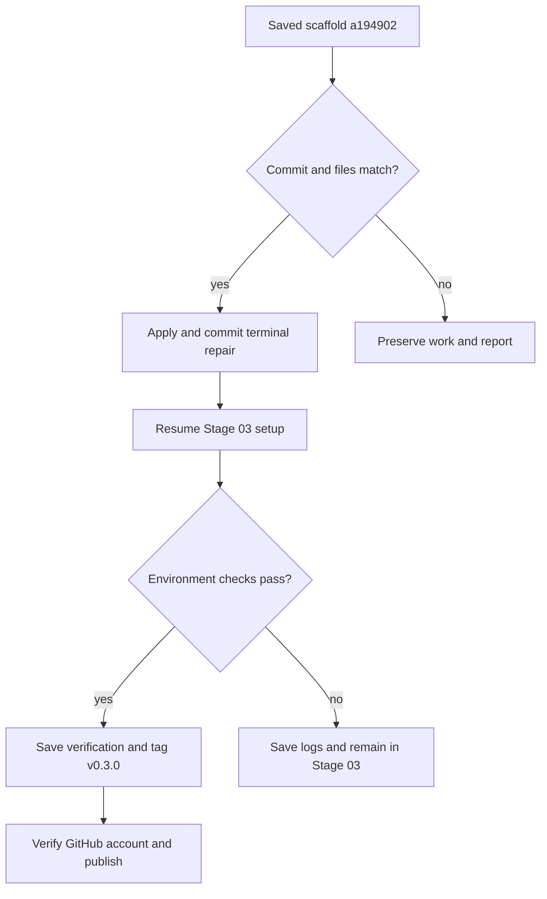

# Stage 03 recovery 01 — terminal access for sudo

Prepared 2026-10-14 for Heavenly's reported scaffold commit:

```text
a194902efa08dd12c5d25138bb063a717f473bc6
```

The scaffold is saved. Setup stopped at its first logged privileged command, before APT installation or Docker/model processing. Stage 03 is still pending; no `v0.3.0` has been earned.

## Why the command failed

The initial interactive `sudo -v` could use your terminal. Later logged commands were launched with Python's `start_new_session=True`, which calls `setsid()` on POSIX. That detaches a child from its controlling terminal. Sudo then cannot open the terminal for authentication; its terminal-scoped authentication state also differs. This was a launcher defect.

The repair preserves the terminal session and foreground process group for sudo commands, including the sudo Docker commands. Standard output/error remain captured, so Docker JSON inspection and setup diagnostics still work. Password input stays between sudo and your terminal: no `sudo -S`, stored password, askpass helper, or password pipeline is introduced.

Output is streamed in chunks so prompts/progress without a newline remain visible. A timeout terminates the sudo client by PID rather than signalling the launcher's shared process group. Other detached jobs retain their group cleanup. Container ownership checks, limits, output folders, package/model pins, and stage gates are retained.

## Apply and continue

Download `rocket-project-stage-03-repair-01.zip` to `~/Downloads/`, then run from a normal terminal:

```bash
python3 "$HOME/Downloads/rocket-project-stage-03-repair-01.zip"
```

Do not add sudo before Python. Enter your password only when the local sudo prompt requests it.

The ZIP verifies the exact reported scaffold commit and every saved source file. It applies the terminal fix, regression tests, and documentation, updates the source checksum list, and creates **one minor Git commit** before continuing setup. It does not create a version tag for this fix or rewrite earlier commits/tags.



Setup continues the original plan: signed Docker/Compose/GitHub CLI installation, containerized dependency locking, image builds, isolation/library checks, verified GGUF download, local model API readiness, cleanup, and GitHub publication as Heavenly-Cyber. Actual Docker and model verification still have to run on your computer. Refer to [the complete Stage 03 manual](STAGE_03_MANUAL.md) for the remaining procedure and resource requirements.

## Retry and diagnostics

Use this **recovery ZIP** for subsequent retries. The original `rocket-project-stage-03.zip` intentionally rejects the repaired source files because its checksums describe the original scaffold.

After the repair commit is saved, you can also resume directly:

```bash
cd "$HOME/git_work/rocket_proplusion_project"
python3 scripts/project.py setup
```

For source repair only, use the recovery ZIP's `--save-only` option. This commits the fix and leaves environment setup pending. `--local-only` runs the local environment checks and defers GitHub publication.

The repair uses its own ignored journal under `logs/setup/`; earlier logs and patch journals are retained. Interrupted source writes or Git hook failures can resume from the exact journaled bytes. User edits, conflicting files, different commits, active project commands, and unexpected tags stop the patch without overwriting them. Ctrl+C during resumed setup allows the project launcher to finish its cleanup rather than immediately killing it from the ZIP wrapper.

Expected initial output:

```text
STAGE_03_REPAIR_01_SAVED
Project: /home/heavenly/git_work/rocket_proplusion_project
Commit: <new repair commit>
Working tree: clean
Minor repair saved; Stage 03 setup resumes. No new tag for this fix.
```

Paste the subsequent terminal output back into the conversation, including any errors. Stage 04 remains pending until the Stage 03 checks and publication succeed.

## Validation

The terminal regression uses real Linux pseudo-terminals and harmless test executables named `sudo`; it never runs privileged commands or reads a real credential. It checks terminal/foreground access, password-style input without logging the synthetic input, captured JSON output, launcher survival after a timeout, and process-group cleanup for ordinary jobs. These tests are included in the worker's pytest suite.

Disposable Git repositories test the repair's exact-base guard, source commit, reapply, preservation, and interruption recovery. Detailed authoring results are recorded with the delivered patch. Real Pop!_OS sudo policy, signed package installation, and Docker/model runs are verified by the command above rather than claimed from these tests.

Authoring results: the original detached-terminal failure was reproduced; all four real-PTY runner regression checks, one real-PTY wrapper Ctrl+C cleanup check, and 14 disposable-repository repair checks passed. No actual sudo command, package installation, or Docker/model run was performed in the authoring environment.

Primary reference: [Python 3.12 subprocess documentation](https://docs.python.org/3.12/library/subprocess.html), especially `start_new_session`, inherited standard streams, and process control.
