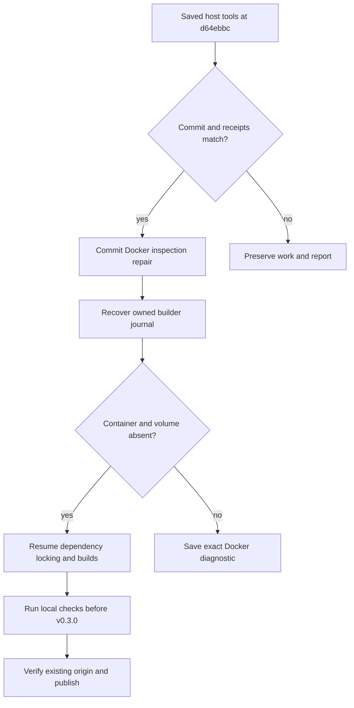

# Stage 03 recovery 02 — Docker cleanup and your SSH remote

Prepared 2026-10-15 from the returned terminal log.

## What is saved

The terminal fix is committed at `2fce1783ca6cac16c873ecd0bd5ed00438e91d82`. Host installation then succeeded and was committed at `d64ebbc`:

| Installed component | Recorded version |
| --- | --- |
| Docker Engine / CLI | 29.9.0 |
| Compose | 5.6.0 |
| GitHub CLI | 2.102.0 |
| Buildx | 0.38.0 |
| containerd.io | 2.4.2 |

Python, uv, and BuildKit images were pulled. The bootstrap image built successfully, and Buildx printed that its temporary builder was removed. The following cleanup inspection stopped before dependency resolution. No production `uv.lock`, propulsion evaluation, or major `v0.3.0` completion is claimed.

## Why cleanup stopped

The original verifier checked only capitalized `No such object/container/image` text. Current Docker CLI source emits lowercase `error: no such object: ...`. This makes the original verifier reject an ordinary missing-resource response after removal. The uploaded log hides the original inspection text, so this is the supported explanation for the observed failure rather than a direct quote of its missing stderr.

The repair accepts recognized missing-resource messages regardless of their capitalization while requiring the exact requested resource name. Permission/connection errors, unrelated names, mixed failures, malformed JSON, or unexpected exit codes still stop the stage. Underlying inspection output is retained under `logs/setup/docker-inspection/` and included in failure messages.

Builder cleanup explicitly inspects the **container and its state volume**. A failed volume query is no longer counted as proof that the volume is gone. Recovery of an interrupted builder journal verifies both resources before marking it removed. Unrelated Docker resources are retained; no global prune is used.

The `InvalidDefaultArgInFrom` messages in the supplied log were Dockerfile warnings. The required digest arguments were passed and the bootstrap build completed; those warnings were not the failure shown here.

## Existing GitHub remote

You have already added:

```text
origin = git@github.com:Heavenly-cyber/rocket_proplusion_project.git
```

The publisher now accepts this SSH URL and preserves it. It checks both the fetch and push destinations against your intended repository. Supported alternatives are the same repository's HTTPS and `ssh://git@github.com/` URLs. It does not run another `git remote add origin`, rewrite your remote, change repository visibility, upload SSH keys, or force-push.

GitHub CLI authenticates API operations such as repository and release checks; SSH Git operations use your host's key/agent. Transport checks use per-command SSH settings with batch mode, verified host keys, and a connection timeout. If local SSH authentication or host verification needs attention, publication stops with your commits/tags saved. Test `ssh -T git@github.com` locally, complete the indicated setup, then run `python3 scripts/project.py publish` after local Stage 03 checks pass. GitHub's successful SSH greeting normally exits with status 1 because it provides no shell.

The default remains a private repository. An existing repository with different ownership/visibility or unfamiliar/divergent history is preserved and reported. Adding `origin` records the address locally; actual remote access and publication are checked by the resumed command.

## Apply and resume

Save `rocket-project-stage-03-repair-02.zip` in `~/Downloads/` and run:

```bash
python3 "$HOME/Downloads/rocket-project-stage-03-repair-02.zip"
```

Run as your normal user. The patch resolves the unique reported `d64ebbc` prefix to the full local commit ID, checks its parent, subject, complete source tree, and saved host-tool receipt, then saves **one minor repair commit** before resuming Stage 03. It does not rewrite earlier commits/tags or change selected dependency/model versions. Installed tools, cached images, pending image pins, earlier logs, and your existing `origin` remain available. Setup may rebuild its temporary bootstrap image because that build was interrupted before the resolver checkpoint.



Use this recovery ZIP for later retries. Earlier ZIPs describe earlier source hashes. You can also resume the repaired repository directly:

```bash
cd "$HOME/git_work/rocket_proplusion_project"
python3 scripts/project.py setup
```

For repair only, append `--save-only` to the ZIP command. To run all local setup but defer publication, append `--local-only`. Neither option advances to Stage 04 automatically.

## Expected output

```text
STAGE_03_REPAIR_02_SAVED
Project: /home/heavenly/git_work/rocket_proplusion_project
Commit: <new minor repair commit>
Working tree: clean
Minor repair saved; Stage 03 setup resumes. No new tag for this fix.
```

Paste the subsequent terminal output, including any error, back into the conversation. Successful `v0.3.0` still requires the actual container/library checks, pinned model checksum, local model API check, and cleanup. GitHub publication is verified separately. Results stay under `resutls/`, logs under `logs/`.

## Validation boundaries

Fifteen regression tests cover missing-object capitalization, exact resource identity, typed volume responses, permission/daemon errors, JSON inspection, builder/container and volume removal, interrupted builder journals, SSH/HTTPS repository matching, fetch/push URL checks, origin preservation, simulated atomic tag publication, access failures, and divergent remote history. Docker and GitHub responses are simulated; the authoring environment has not run a real Docker daemon, the selected model, or real GitHub publication.

Twelve installation checks use disposable real Git repositories. They verify one clean minor commit, original tags and remote/config preservation, retained logs/cache, idempotent retries, refusal of later unrelated commits, preservation of tracked/untracked edits and symlink targets, interrupted-commit recovery, active-command locking, receipt validation, payload integrity, and the production base-commit requirement. Four existing terminal regression tests also run against the updated host runner using harmless sudo-named shims and real pseudo-terminals. No real sudo or password is used in those tests. The user-run command performs the actual Docker and publication checks.

Primary references, consulted 2026-10-15:

- [Docker inspect reference](https://docs.docker.com/reference/cli/docker/inspect/) describes JSON output and object-type selection.
- [Docker CLI inspect source](https://github.com/docker/cli/blob/master/cli/command/system/inspect.go) emits the lowercase missing-object message. This is a current-source observation; the uploaded log did not expose the exact failing inspection text.
- [GitHub remote repositories](https://docs.github.com/en/get-started/git-basics/managing-remote-repositories) documents SSH and HTTPS remote URLs.
- [Git configuration](https://git-scm.com/docs/git-config) documents per-command `core.sshCommand`; [GitHub SSH testing](https://docs.github.com/en/authentication/connecting-to-github-with-ssh/testing-your-ssh-connection) explains authentication and the successful greeting's exit status.
