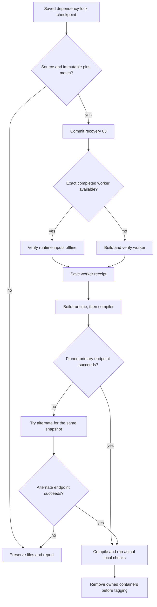

# Stage 03 recovery 03 - pinned snapshot downloads

## Installer correction 03a

Use `rocket-project-stage-03-repair-03a.zip` for the current retry. The earlier ZIP compared the Python range as literal text and rejected your valid `requires-python = "==3.13.*"` lock. That check ran before source files, journals, or commits were written, so the local checkpoint remains `3909600`. This corrected ZIP applies the same pending minor repair from that checkpoint.

The corrected check recognizes `==3.13.*` and the reviewed `>=3.13,<3.14` form. The exact Python build remains **3.13.16**, pinned through the saved environment and base-image digest. The correction does not edit or regenerate `uv.lock`. It additionally verifies the byte hashes of the two lock files from your updated project ZIP:

| Existing file | Verified SHA-256 |
| --- | --- |
| `uv.lock` | `1d61509065de71d49fb26e4f7e8df6912f6584f9c3ca3dffeed839eefd94de1a` |
| `configs/environment-lock.json` | `595dad816ad6abc3902db5697564188bd01515580ada37e7edf509a955fd96d9` |

All 52 previously known source/host-receipt files and all selected dependency versions match the uploaded checkpoint. The complete 36-package lock is used for the corrected installer's tests rather than a reconstructed example. No packages are installed in those tests.

Save the new ZIP in `~/Downloads/`, then run:

```bash
python3 "$HOME/Downloads/rocket-project-stage-03-repair-03a.zip"
```

Look for `INSTALLER_REVISION: 03a`, followed by `STAGE_03_REPAIR_03_SAVED`. The minor commit and later Stage 03 checks retain their original names. Continue to use this corrected ZIP for retries. The recovery logic below is otherwise unchanged.

Prepared 2026-10-15 from the returned terminal output and presentation guidelines.

## Current saved checkpoint

Repair 02 is saved at `3a03de17b89a9fc8d430a7bda144058ed5c5a8ca`. Dependency resolution then succeeded and was committed at `3909600` with `uv.lock` and `configs/environment-lock.json`. The worker image finished building after installing 34 packages. The log records configuration digest `sha256:1effcc868f455330e55678fc4adbeebcf30c95512515e9b87aa3848b1a3905fe` and manifest digest `sha256:1921a773615c43c11d0212aa511709efabbed307d9b23f2f68bae23c848b92cb`; recovery checks both supported content identities.

The new failure was an HTTPS connection timeout to `snapshot.debian.org` during the llama.cpp image build. One APT phase fetched package metadata and started downloads; the other could not complete its package index. APT then printed `Unable to locate package libgomp1`. The log establishes failed connectivity and incomplete metadata; it does not establish that `libgomp1` is absent from Debian.

The temporary builder was removed. No successful llama.cpp build, model API verification, scientific evaluation, or `v0.3.0` completion is claimed.

The first supplied `project.zip` predated Repair 02. Your updated ZIP now contains Repair 02 source and the actual saved lock files. Its contents match the expected checkpoint; the original archive is preserved. This patch checks the Git checkpoint on your system and applies only its listed recovery files.

## What the repair saves

1. A bounded snapshot downloader inside the image build. APT retries each failed transfer twice, uses 30-second transport timeouts, and fails the metadata phase on any error. Each endpoint's update command has a 300-second bound; its install command has a 1,200-second bound. The existing overall build limit also applies.
2. An alternate HTTPS endpoint, `snapshot-cloudflare.debian.org`, for the **same** Debian/security archives and `20261014T000000Z` timestamp. Source-file validation allows only that hostname substitution. Debian archive signatures and package hashes remain required. No rolling mirror or host APT-source change is introduced.
3. Serialized package phases: the compiler stage derives from the runtime stage, so their APT transfers do not run concurrently. Successful runtime/compiler transport receipts record the actual endpoint and attempts.
4. Recovery of the completed worker image when its exact immutable identity is available. An offline, bounded, nonroot job checks Python, uv, selected package versions, every application-source file, configuration files, and the current `uv.lock` before adoption. Missing images are rebuilt. A mismatch stops the stage and is logged.
5. A saved worker-image receipt before starting the llama.cpp build. If the latter fails again, a retry can reuse that verified worker rather than redownload its Python packages. Tests and lint use the current committed `scripts/`, `tests/`, and `docker/` directories through read-only code mounts; reused worker images can contain older orchestration files internally.
6. The original presentation-guidelines PDF and [a nine-point evidence mapping](PRESENTATION_ALIGNMENT.md), including the required separation of proposed, expected, and demonstrated findings.

The selected package/model versions, immutable base-image digests, llama.cpp source commit, GitHub SSH `origin`, and earlier commits/tags are retained. The patch creates one minor source commit before resuming setup. A major tag still follows actual local verification.



If both endpoints are unavailable, the build stops with the attempts in its log. Endpoint availability from this authoring environment does not prove reachability from your network. This repair improves recovery; it cannot guarantee an uninterrupted download.

## Apply and continue

Download `rocket-project-stage-03-repair-03a.zip` into `~/Downloads/`, then run as your normal user:

```bash
python3 "$HOME/Downloads/rocket-project-stage-03-repair-03a.zip"
```

The recovery ZIP uses Python 3.11+ for TOML inspection; your reported host Python 3.12.3 is supported. It resolves the unique `3909600` prefix locally, checks its exact parent/subject/changed files, validates all saved source bytes, validates the selected versions and immutable environment pins, and verifies that `uv.lock` matches its recorded checksum. It does not re-resolve that lock.

Expected first checkpoint:

```text
INSTALLER_REVISION: 03a
STAGE_03_REPAIR_03_SAVED
Project: /home/heavenly/git_work/rocket_proplusion_project
Commit: <minor repair commit>
Working tree: clean
Minor repair saved; Stage 03 setup resumes. No new tag for this fix.
```

Where the completed image is available and passes its input check, setup also prints `WORKER_IMAGE_REUSED`. Normal sudo prompts remain local to your terminal. Use this ZIP for later retries, or run:

```bash
cd "$HOME/git_work/rocket_proplusion_project"
python3 scripts/project.py setup
```

`--save-only` saves the source repair without Docker execution. `--local-only` completes local setup while leaving GitHub publication pending. If publication alone needs a retry after local readiness, use `python3 scripts/project.py publish`.

Return the full terminal output. Stage 04 remains pending. Close heavy applications if the later model check reports less than 6 GiB available RAM.

## Files and cleanup

Software-readiness outputs, including worker-input proofs, use `resutls/<run-id>/`. Container/build/setup logs use `logs/`. Pending worker receipts use ignored `tmp/setup/`. All disposable jobs and builders retain the existing bounded cleanup rules. Image/model caches and the installed Docker service remain available; unrelated Docker resources are preserved.

## Validation and limits

The authoring checks use simulated APT/Docker responses and disposable real Git repositories; no APT installation, real Docker build, or model inference was run here. Fifteen recovery tests cover incomplete indexes, package-transfer failures, fixed-date fallback, exhausted endpoints, changed source files, command timeouts, cached-worker input checks, both recorded image identity forms, and worker reuse after a failed llama.cpp build. Thirteen installation scenarios verify preservation, locking, saved-pin validation, commit recovery, archive integrity, and idempotence. Earlier Docker/SSH and pseudo-terminal regressions are also rerun against the combined source. Actual container isolation, installed dependencies, compilation, model checks, and cleanup are still verified on your host before `v0.3.0`.

Primary references consulted 2026-10-15:

- [Debian snapshot usage](https://snapshot.debian.org/) describes date-based archives and signed APT access; [the alternate snapshot frontend](https://snapshot-cloudflare.debian.org/) serves the archive interface.
- [APT configuration](https://manpages.debian.org/trixie/apt/apt.conf.5.en.html) documents retries and download queue options; [APT HTTP transport](https://manpages.debian.org/trixie/apt/apt-transport-http.1.en.html) documents transport timeouts.
- [APT update error handling](https://manpages.debian.org/trixie/apt/apt-get.8.en.html) documents `--error-on=any`, preventing incomplete metadata from being treated as a completed update.
- [Python version specifiers](https://packaging.python.org/en/latest/specifications/version-specifiers/) defines wildcard prefix matching; [uv's resolver documentation](https://docs.astral.sh/uv/reference/internals/resolver/) discusses `==3.13.*` as a bounded Python requirement.
- Course requirements: the supplied [original final-presentation guidelines](requirements/final-presentation-guidelines.pdf), retained byte-for-byte. The alignment document distinguishes project proposals and hypotheses from validated results.
