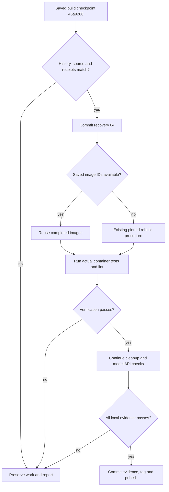

# Stage 03 recovery 04 — nonroot verification tests

Prepared 2026-10-15 from the latest returned terminal log.

## Download and run

Save `rocket-project-stage-03-repair-04.zip` in `~/Downloads/`, then run from your normal account:

```bash
python3 "$HOME/Downloads/rocket-project-stage-03-repair-04.zip"
```

Do not unzip it into the repository. The executable ZIP checks the saved checkpoint, saves one minor repair commit, and resumes Stage 03. Use this same ZIP for retries and return the full output before Stage 04.

The default target remains `~/git_work/rocket_proplusion_project/`. No host Python packages are needed. Host Python 3.11+ is required; the reported Python 3.12.3 is supported.

## What has actually succeeded

The latest run saved recovery 03 at `98aff7d773eff0db2bd645107f669903af8f15c2`, verified and reused the worker image, completed the pinned Debian runtime/compiler downloads, and compiled llama.cpp. The offline server-help and compiler/source/transport receipt checks passed. Image evidence was then committed at **`45a9266`**, subject `build: save container image identities and compiler receipts`.

The subsequent real Docker test run reported **35 passed, 5 failed**. Its temporary container was removed. No `v0.3.0` completion, model download/API success, benchmark score, or scientific finding is established by this log.

The uploaded project ZIP still contains the earlier source snapshot; the returned terminal log records the newer checkpoint. This recovery uses that log and the already published source manifests to verify the actual local Git history before writing files. It does not restore the older ZIP over the current repository.

## Why those five tests failed

| Failure | Evidence from the log | Repair |
| --- | --- | --- |
| One credential-mount check | Python 3.13 raised `PermissionError` while a nonroot process tried `Path('/root/.config/gh').exists()` | Inspect `/proc/self/mountinfo` for protected mounts and their ancestors/children without traversing `/root` |
| Four terminal-runner checks | `Popen` could not execute temporary fixture scripts, despite their execute bits | Keep fixtures nonexecutable and interpret their contents with the installed Python binary |

The first error does not establish that credentials were mounted. The second establishes that execution of those temporary files was blocked; the log does not include mount flags proving the precise restriction. The repair works without requiring executable temporary storage. Earlier authoring checks missed these nonroot/container assumptions; the repaired paths are exercised with real permission-denied fixtures before delivery. This authoring environment maps only UID 0 and prevents switching users; its process has no effective capabilities. Actual nonroot Docker verification remains a gate on your host.

The mount check rejects additional mounts at `/root`, GitHub/SSH credential directories, either Docker socket location, `/app/.git`, `/app/.env`, `/models`, and relevant ancestors or children. Linux mount-path escapes are decoded. Empty or malformed metadata fails the check. The normal image root filesystem and approved code/output/tmp mounts are allowed. This verifies the stated mount policy; it does not inspect arbitrary files hidden inside inaccessible directories.

The terminal tests still use real Linux pseudo-terminals and the production `Runner`. `Runner` receives the original fixture name `sudo` or `ordinary-job`, so it exercises the actual foreground/detached-session decision. A test-only launch adapter changes the final executable to Python and forwards every `Popen` option unchanged. The tests still check foreground terminal input, captured JSON, absence of the synthetic password from logs, timeout survival, and detached child-process cleanup. They never invoke real sudo or use a real credential. No test is skipped or changed to treat a permission error as proof of absence.

## Saved changes and preserved work

The payload updates the two failed test files, adds a small mount-metadata helper and its regression tests, updates the source/history guard, and updates the manuals. It creates one commit with subject:

```text
fix: verify isolation and terminal fixtures as nonroot
```

The minor repair creates no tag. `v0.3.0` still requires the actual local checks and cleanup.

| Preserved input or setting | Behavior |
| --- | --- |
| Completed worker and llama images | Existing setup reuses saved IDs when available; missing images follow the existing pinned rebuild procedure |
| `uv.lock` and environment/host/build receipts | Validated and retained byte-for-byte |
| Python 3.13.16, uv 0.13.1, llama.cpp source, model and dependencies | No version selection changes or dependency re-resolution |
| Container settings and recipes | Nonroot, read-only root, dropped capabilities, no-new-privileges, limits and network policy remain in force |
| Earlier commits and annotated tags | Retained; no reset, tag rewrite or force-push |
| SSH `origin` | Existing `git@github.com:Heavenly-cyber/rocket_proplusion_project.git` retained |
| Existing results, logs and caches | Retained; new outputs go to their existing dedicated folders |

Current committed `scripts/`, `tests/`, and `docker/` files are already mounted read-only for verification. That mechanism lets the test repair run with the existing worker image. This patch does not alter `scripts/environment.py`, `scripts/container_jobs.py`, `scripts/model_session.py`, or any Dockerfile.

## Procedure and checkpoints



Failure/interrupt paths retain the existing container cleanup and logging handlers. No builder is started merely to apply this source patch.

The installer resolves the unique `45a9266` commit locally and checks its exact parent, subject, and changed-file set. It verifies the known source bytes and both actual uploaded lock hashes. It compares the saved build receipt with the returned compiler/runtime package inventories, snapshot transport receipts, runtime-input fingerprint, source revision and observed image identities. Docker's reviewed manifest/config identity forms are both accepted. The receipt itself is never regenerated or replaced by this patch.

First expected output:

```text
INSTALLER_REVISION: 04
STAGE_03_REPAIR_04_SAVED
Project: /home/heavenly/git_work/rocket_proplusion_project
Commit: <new minor repair commit>
Working tree: clean
Minor repair saved; Stage 03 setup resumes. No new tag for this fix.
```

Normal local sudo prompts may follow. If the images are still present, the existing receipt path resumes verification without compiling llama.cpp again. Later work includes the roughly 2.55 GiB model download and local API check; close heavy applications if the launcher reports less than 6 GiB currently available RAM.

Successful local completion prints `STAGE_03_LOCAL_READY` and records annotated `v0.3.0`. Successful GitHub publication then prints `STAGE_03_SAVED_AND_PUBLISHED`. A failure prints a pending diagnostic and retains prior saved checkpoints. Return the complete output in either case.

Optional commands:

```bash
# Save only the minor source repair; do not run Docker or installation.
python3 "$HOME/Downloads/rocket-project-stage-03-repair-04.zip" --save-only

# Perform all local checks, leaving GitHub publication pending.
python3 "$HOME/Downloads/rocket-project-stage-03-repair-04.zip" --local-only
```

After the repair is saved, `python3 scripts/project.py setup` is also a valid retry from the project directory. Preserve unexpected Git changes and return the diagnostic instead of resetting them.

## Outputs, validation and scope

Readiness records use `resutls/<run-id>/`; operational logs use `logs/<run-id>/` and `logs/setup/`. Temporary patch work stays in ignored `tmp/patches/`. Reusable images/models remain cached. Disposable containers, project networks and build instances retain the existing cleanup rules; unrelated Docker resources are preserved.

Authoring validation exercises the repaired mount parser and real terminal/process behavior with nonexecutable and unreadable fixtures in a capability-free process, plus disposable real Git histories for install, retry, interrupted commits, integrity and preservation. The authoring host has no pytest; a small explicit adapter invokes the regression functions and their parameter cases. Its interpreter is Python 3.12.14. This does not establish a nonroot Docker/Python 3.13 pass. It does not run a real Docker build, install APT packages or run scientific/model calculations here. The full pytest/Ruff/container/model gates execute on the user's system. These checks validate software setup, not the proposed research gap or a scientific solution.

Primary implementation references:

- [Python 3.13 pathlib](https://docs.python.org/3.13/library/pathlib.html): filesystem errors and path existence checks.
- [Linux `/proc/pid/mountinfo`](https://docs.kernel.org/filesystems/proc.html): mount identifiers, mount-point fields and escaped paths.
- [Docker tmpfs mounts](https://docs.docker.com/engine/storage/tmpfs/): temporary-mount options and execution restrictions.
- [Python subprocess](https://docs.python.org/3.13/library/subprocess.html): argument sequences and session handling.

The course-guideline mapping remains in [PRESENTATION_ALIGNMENT.md](PRESENTATION_ALIGNMENT.md). Stage 04 and all benchmark measurements remain pending until this stage is saved and reviewed.
